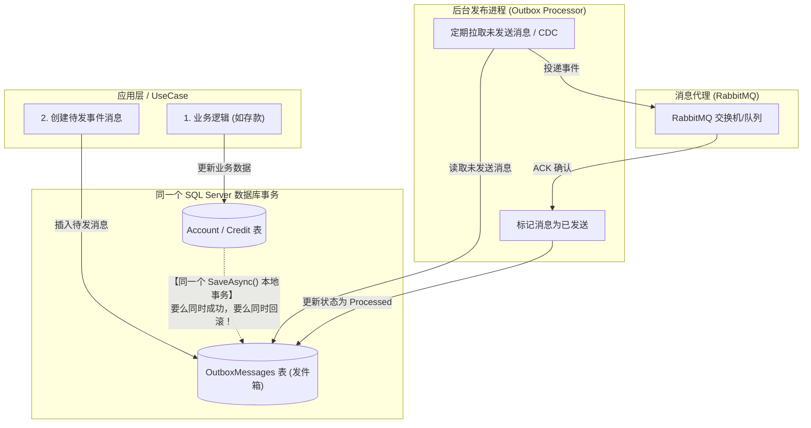
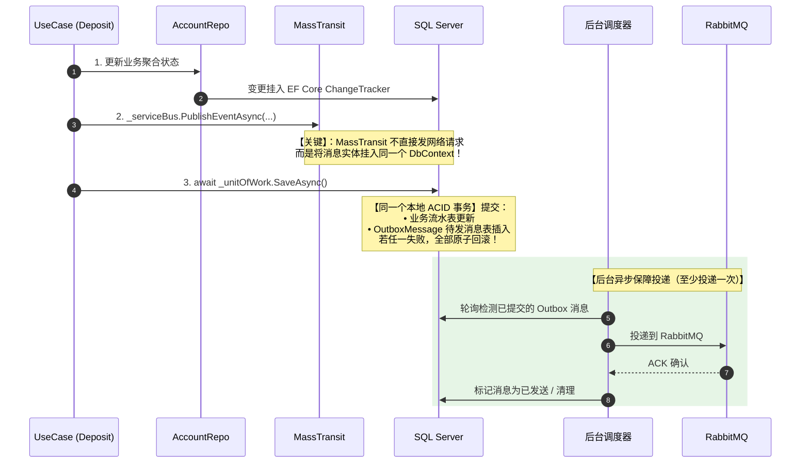
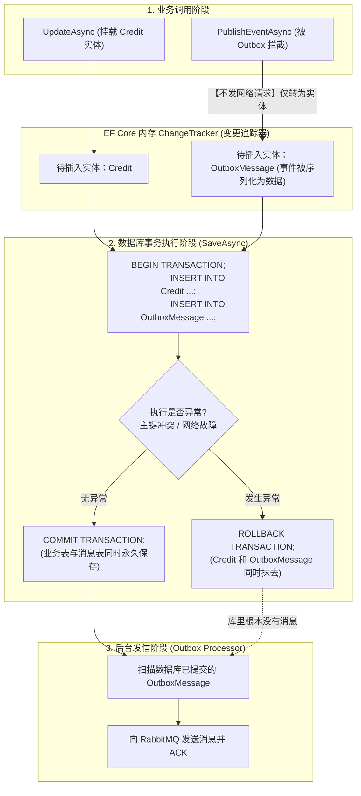
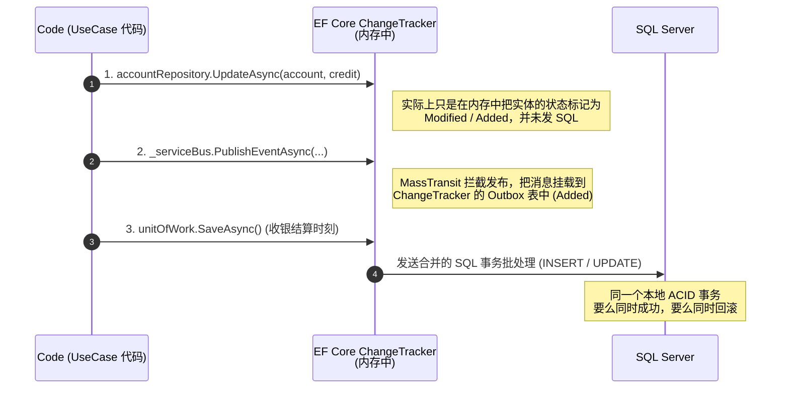

在真实企业项目中，通常无需手动手写发件箱轮询，我们会使用MassTransit Outbox，用于解决双写不一致问题。

我们可以打开CleanArchitecture模板的应用层的UseCase业务编排，看看Deposit.cs ：

```cs
public sealed class Deposit(
                        IEntityFactory entityFactory,
                        IOutputPort<DepositOutput> outputHandler,
                        IAccountRepository accountRepository,
                        IUnitOfWork unitOfWork,
                        IServiceBusClient serviceBus) : IUseCase<DepositInput>
{
    private readonly IEntityFactory _entityFactory = entityFactory ?? throw new ArgumentNullException(nameof(entityFactory));
    private readonly IOutputPort<DepositOutput> _outputHandler = outputHandler ?? throw new ArgumentNullException(nameof(outputHandler));
    private readonly IAccountRepository _accountRepository = accountRepository ?? throw new ArgumentNullException(nameof(accountRepository));
    private readonly IUnitOfWork _unitOfWork = unitOfWork ?? throw new ArgumentNullException(nameof(unitOfWork));
    private readonly IServiceBusClient _serviceBus = serviceBus ?? throw new ArgumentNullException(nameof(serviceBus));

    public async Task ExecuteAsync(DepositInput input, CancellationToken cancellationToken = default)
    {
        var account = await _accountRepository.GetAsync(input.AccountId, cancellationToken);
        if (account == null)
        {
            _outputHandler.Error($"The account {input.AccountId} does not exist or is already closed.");
            return;
        }

        var credit = account.Deposit(_entityFactory, input.Amount);

        await _accountRepository.UpdateAsync(account, credit, cancellationToken);

        await _serviceBus.PublishEventAsync(new Contracts.Events.DepositCompleted() { AccountId = input.AccountId, Amount = input.Amount.ToMoney().ToDecimal() }, cancellationToken);

        await _unitOfWork.SaveAsync(cancellationToken);

        DepositOutput output = new DepositOutput(
            credit,
            account.GetCurrentBalance());

        _outputHandler.Default(output);
    }
}
```

这个代码比较精彩，可以仔细看，这个代码把输入/输出端口模式使用上了，我们甚至可以直接脱离HTTP上下文，能够被API、GRPC甚至是控制台程序复用。

它依赖仓储IAccountRepository 获取聚合根，调用聚合根的业务方法 account.Deposit(...)，最后调用 IUnitOfWork.SaveAsync() 统一提交事务。

```cs
await _accountRepository.UpdateAsync(...); // 1. 更新
await _serviceBus.PublishEventAsync(...);  // 2. 发消息到 RabbitMQ/Redis
await _unitOfWork.SaveAsync(...);          // 3. 提交数据库事务
```

如果第二步消息发送成功了，但是第三步的数据库SaveAsyc因为网络抖动或者主键冲突导致失败了，或者是数据库回滚了，那么消费者就会收到存款成功但是没有落库的情况。

## 事务性收发件

那么怎么避免这种情况，那么应该使用**事务性发件箱模式**




可以在数据库新建一张叫做OutboxMessage的表：

```sql
CREATE TABLE OutboxMessages (
	Id UNIQUEIDENTIFIER PRIMARY KEY,
	OccurredOn DATETIME2 NOT NULL,
	Type NVARCHAR(255) NOT NULL,
	Content NVARCHAR(MAX) NOT NULL,
	ProcessedOn DATETIME2 NULL
);
```

在用例中统一落库：

```cs
  // 业务更新
    await _accountRepository.UpdateAsync(account, credit, cancellationToken);

    // 不直接调 RabbitMQ 发网络请求，而是向本地 Outbox 表塞一条记录
    _context.OutboxMessages.Add(new OutboxMessage(
        id: Guid.NewGuid(),
        type: nameof(DepositCompleted),
        content: JsonSerializer.Serialize(new DepositCompleted { ... })
    ));

    // 关键点：业务数据和 Outbox 消息在【同一个数据库事务中原子提交】！
    // 如果报错，全部回滚，绝对不会产生“幽灵消息”！
    await _unitOfWork.SaveAsync(cancellationToken);
```

后台 Worker 异步保障投递：

• 项目中的 dddotNet.Worker 可以起一个后台任务（BackgroundService）；
• 每隔几百毫秒扫一次 OutboxMessages 表中 ProcessedOn IS NULL 的记录，投递给 RabbitMQ；
• RabbitMQ 返回确认（ACK）后，打上 ProcessedOn = DateTime.UtcNow；
• 即使宕机，下次重启会继续扫表重投（保证至少投递一次 At-Least-Once Delivery）。

在真实的开发场景中，通常是无需手写发件箱轮询的，因为.net生态有两个及其成熟的解决方案：

MassTransit Outbox（推荐）：如果该项目后续将 Rebus 升级为 MassTransit，直接开启：`cfg.AddEntityFrameworkOutbox<GenocsContext>()` 业务代码只需 await publishEndpoint.Publish(...)，框架会自动劫持并走 Outbox 事务落库与后台派发。

DotNetCore.CAP：国内广泛采用的分布式事务与 EventBus 方案，原生内置基于 EF Core 的 Outbox 实现与自动重试机制。

我们这里通过MassTransit Outbox来改造一下，后续也可以将rebus升级为masstransit。

核心执行时序（Outbox 怎么解决双写问题）：




实现：

 在 Infrastructure.csproj 中引入了 MassTransit 的 EF Core 发件箱与 RabbitMQ 传输库，我们在GenocsContext.cs:18-21 的 OnModelCreating 中注入发件箱表映射：

```cs
namespace dddotNet.Infrastructure.PersistenceLayer.SQLServer;

public sealed class GenocsContext(DbContextOptions options) : DbContext(options)
{
    public DbSet<Account> Accounts { get; set; }
    public DbSet<Customer> Customers { get; set; }
    public DbSet<Credit> Credits { get; set; }
    public DbSet<Debit> Debits { get; set; }

    protected override void OnModelCreating(ModelBuilder modelBuilder)
    {
        base.OnModelCreating(modelBuilder);

        // MassTransit EntityFrameworkCore Outbox 实体映射
        modelBuilder.AddInboxStateEntity();
        modelBuilder.AddOutboxMessageEntity();
        modelBuilder.AddOutboxStateEntity();

        modelBuilder.Entity<Account>()
            .ToTable("Account");

        modelBuilder.Entity<Account>()
            .Ignore(p => p.Credits)
            .Ignore(p => p.Debits);

        modelBuilder.Entity<Customer>()
            .ToTable("Customer")
            .Property(b => b.SSN)
            .HasConversion(
                v => v.ToString(),
                v => new SSN(v));

        modelBuilder.Entity<Customer>()
            .ToTable("Customer")
            .Property(b => b.Name)
            .HasConversion(
                v => v.ToString(),
                v => new Name(v));

        modelBuilder.Entity<Customer>()
            .Ignore(p => p.Accounts);

        modelBuilder.Entity<Debit>()
            .ToTable("Debit")
            .Property(b => b.Amount)
            .HasConversion(
                v => v.ToMoney().ToDecimal(),
                v => new PositiveMoney(v));

        modelBuilder.Entity<Credit>()
            .ToTable("Credit")
            .Property(b => b.Amount)
            .HasConversion(
                v => v.ToMoney().ToDecimal(),
                v => new PositiveMoney(v));
    }
}

```

实现与架构抽象对齐的 ServiceBusClient，创建 MassTransitServiceBusClient.cs：

```cs
public sealed class MassTransitServiceBusClient(IPublishEndpoint publishEndpoint) : IServiceBusClient
{
    private readonly IPublishEndpoint _publishEndpoint = publishEndpoint ?? throw new ArgumentNullException(nameof(publishEndpoint));

    public async Task SendCommandAsync<T>(T command, CancellationToken cancellationToken = default)
        where T : Genocs.Common.CQRS.Commands.ICommand
    {
        await _publishEndpoint.Publish(command, cancellationToken);
    }

    public async Task PublishEventAsync<T>(T message, CancellationToken cancellationToken = default)
        where T : Genocs.Common.CQRS.Events.IEvent
    {
        await _publishEndpoint.Publish(message, cancellationToken);
    }
}

```

在 `Deposit` 用例中，调用了 `await _serviceBus.PublishEventAsync(...)`。  
在这个实现里，底层实际上是调用了 MassTransit 的 `_publishEndpoint.Publish(...)`。因为这里注入的是 `IPublishEndpoint`（而不是 `IBus` 或 `ISendEndpoint`），当你的项目配置了 MassTransit EF Core Outbox 后，这个 `Publish` 方法根本不会立刻向 RabbitMQ 发送网络请求

它会将消息实体附加到当前的 EF Core `DbContext` 中。随后你的 `_unitOfWork.SaveAsync()` 执行时，业务数据和 Outbox 消息会在**同一个本地事务**中提交。

然后我们去在 DI 容器中开启 Bus Outbox 管道，创建了配置扩展MassTransitInfrastructureExtensions.cs：


```cs
 services.AddMassTransit(x =>
    {
        // 挂载 EF Core 事务性发件箱
        x.AddEntityFrameworkOutbox<GenocsContext>(o =>
        {
            o.UseSqlServer();
            o.UseBusOutbox(); // 启用总线发件箱：所有发布事件进入同一个 DbContext 事务
        });

        // 配置 RabbitMQ 传输
        x.UsingRabbitMq((context, cfg) =>
        {
            cfg.Host(rabbitHost, virtualHost, h =>
            {
                h.Username(rabbitUser);
                h.Password(rabbitPass);
            });
            cfg.ConfigureEndpoints(context);
        });
    });

    // 将抽象接口注入为 Scoped，与当前请求的 DbContext 处于同一个事务生命周期
    services.AddScoped<IServiceBusClient, MassTransitServiceBusClient>();
```

并在 Program.cs:58 中完成了装配替换：

```cs
services.AddMassTransitWithOutbox(builder.Configuration);
```

这样即便上面的第 3 步 `_unitOfWork.SaveAsync()` 发生主键冲突或网络断连，业务表与 Outbox 表同时回滚，绝不会向 RabbitMQ发出幽灵消息。

## 回滚机制


回滚把一个原本无法回滚的网络调用，变成了一个能参与本地事务的数据表写入。

在改造前，当执行到第二步时：

```cs
    await _serviceBus.PublishEventAsync(...); // 此时直接通过 TCP 发送 AMQP 数据包给 RabbitMQ
    await _unitOfWork.SaveAsync(...);         // 此时向 SQL Server 发送 SQL
```

改造和配置了 `x.AddEntityFrameworkOutbox<GenocsContext>() 和 o.UseBusOutbox()` 之后，底层的执行逻辑发生了根本性改变



当调用了 `await _serviceBus.PublishEventAsync(new DepositCompleted { ... });` 的时候，由于开启了UseBusOutbox的MassTransit根本没有向RabbitMQ发送任何网络通信，它仅仅把事件对象序列化为了json文本，创建了一个OutboxMessage数据实体，直接塞进了当前同一个GenocsContext 的内存变更追踪器中。

当紧接着调用： `await _unitOfWork.SaveAsync(cancellationToken);` 之后，在底层，EF Core 的 SaveChangesAsync 默认会自动打开一个 SQL Server本地事务。它向数据库发送的实际上是这样一段批处理：

```sql
   BEGIN TRANSACTION;

    -- ① 插入充值流水业务记录
    INSERT INTO [Credit] ([Id], [AccountId], [Amount], [TransactionDate])
    VALUES ('c1...', 'a1...', 100.00, '2026-10-25');

    -- ② 插入待发消息发件箱记录
    INSERT INTO [OutboxMessage] ([SequenceNumber], [MessageId], [Body], ...)
    VALUES (1, 'm1...', '{"AccountId":"a1...", "Amount":100}', ...);

    COMMIT TRANSACTION;
```

如果一切正常：两个 INSERT 全部成功，COMMIT TRANSACTION，数据与待发消息同时落盘，如果第 ① 步或第 ② 步有任何报错（例如主键冲突、外键约束、数据库磁盘满、网络超时中断）：
      • 数据库引擎立即触发 ROLLBACK TRANSACTION；
      • Credit 记录回滚了，OutboxMessage 待发消息记录也同步被物理撤销/回滚！
      • 内存里的 DbContext 抛出异常，整个用例中止。

在整个过程中，负责真正往 RabbitMQ 发消息的是 MassTransit 注册在后台的独立工作者：

  • 这个后台工作者只会去读取数据库中已经真正 Commit 成功的 OutboxMessage 记录。
  • 既然刚才的事务回滚了，数据库里压根就没有产生过这条 OutboxMessage 记录！
  • 后台工作者什么也查不到，因此 RabbitMQ 永远不会收到这笔错误的存款事件。

### 内存追踪变更器

 如果没有 ChangeTracker（内存变更追踪器），上述的 Outbox 机制、工作单元以及整洁架构里的事务一致性，根本无法成立。

这个也是ef core的关键部分，下面我们拆解一下它是如何工作的：

你可以把 DbContext 想象成去超市购物，而 ChangeTracker 就是你的“购物车”：

  • 当你挑选商品放进购物车时（调用 AddAsync / 修改属性 / 发送事件），你根本还没有付钱（没有发送任何
  SQL，也没有向网络发包）。
  • 此时所有的变化，都只是放在这辆购物车里的物品，每个物品上面贴了一张“操作便签”（状态标记）。
  • 只有当你推着购物车到收银台，执行 SaveChangesAsync()
  时，收银台（数据库）才一口气把车里所有的东西打在一张账单上完成结算（事务提交）。


ef core内部，每一个被管理的对象，都会被包装为一个EntityEntry，ChangeTracker会为其维护一个状态叫做EntiryState

EntityState 的 5 种状态

|状态|含义|场景 / 如何触发|`SaveChanges()` 时的动作|
|---|---|---|---|
|**`Added`**|新增|调用了 `_dbContext.Add(entity)` 或构造函数创建的新对象被添加|生成 `INSERT` 语句|
|**`Unchanged`**|未改变|从数据库 `GetAsync` 查出来，且没做任何修改|忽略，不生成 SQL|
|**`Modified`**|已修改|查出来后，修改了实体的某个属性|生成 `UPDATE` 语句（只更新修改的字段）|
|**`Deleted`**|已删除|调用了 `_dbContext.Remove(entity)`|生成 `DELETE` 语句|
|**`Detached`**|游离|对象没有在 `ChangeTracker` 的追踪范围内（比如 `new` 出来但没 `Add`）|完全忽略，即使你改了它也不生效|

他如果知道你改了什么：

当你从数据库查出一个实体时，ChangeTracker 会在内存中存放一个快照（Original Values 快照）。当调用 SaveChangesAsync() 时，它会拿当前对象的属性和底片进行比对（Dirty Checking脏检查），发现哪个属性变了，就精准生成对应字段的 UPDATE 语句。


我们来还原在用例 Deposit.cs 执行的那几毫秒内，ChangeTracker 内存里的真实演变：



为什么必须共享同一个changeTracker：

这里有一个至关重要的底层设计 —— 依赖注入的生命周期（Scoped），在 ASP.NET Core 中，每次 HTTP 请求都会创建一个独立的生命周期作用域（Scope）。仓储 AccountRepository 注入的 GenocsContext 是这个 Scope 里的实例，MassTransit Outbox 拿到的也是同一个 GenocsContext 实例，因此，它们共享了同一台 ChangeTracker。

> 如果没有这套内存共享机制：仓储在自己的连接里写业务，MQ 在自己的地方发消息，两方互不知晓，就必然退化成各自为政的“双写不一致”。

正是因为有了 ChangeTracker 这个内存中转站，我们才能在业务上保持优雅解耦（业务代码只需安心调用 Update 和Publish），而在技术底层却能神不知鬼不觉地把所有的增删改和待发消息“打包捆绑”**在同一个事务里交付数据库。


