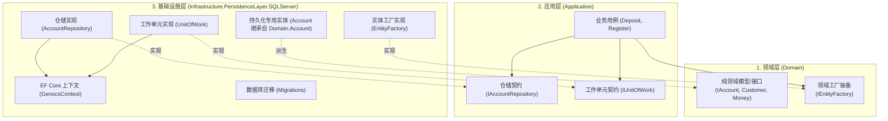
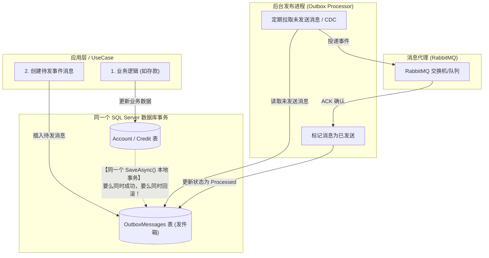

这个是个非常典型的基于DDD实践的，和基于Genocs工具包实现的一个模板文件，我们·可以基于命令简单的通过模板创建项目和部署。

我们可以在终端里用dotnet命令安装模板和指定版本：

```shell
# .NET 7/8/9/10+ 推荐命令
dotnet new install Genocs.CleanArchitecture.Template

# 如需安装指定版本（可选）
dotnet new install Genocs.CleanArchitecture.Template::9.0.0
```

>注：在较旧的 .NET 6 及更早版本中，安装语法为 dotnet new -i Genocs.CleanArchitecture.Template。

模板对应的短名称（Short Name）为 gnx-cleanarchitecture，可以通过 --help查看支持的全部配置项（如支持的数据库、消息代理选型等）：
`dotnet new gnx-cleanarchitecture --help`

```shell
[17:27:11] PS C:\Users\20742>  dotnet new gnx-cleanarchitecture --help
Genocs: Clean Architecture Template (C#)
Author: Nocco Giovanni Emanuele

Usage:
  dotnet new gnx-cleanarchitecture [options] [template options]

Options:
  -n, --name <name>       The name for the output being created. If no name is specified, the name of the output
                          directory is used.
  -o, --output <output>   Location to place the generated output.
  --dry-run               Displays a summary of what would happen if the given command line were run if it would result
                          in a template creation. [default: False]
  --force                 Forces content to be generated even if it would change existing files. [default: False]
  --no-update-check       Disables checking for the template package updates when instantiating a template. [default:
                          False]
  --project <project>     The project that should be used for context evaluation.
  -lang, --language <C#>  Specifies the template language to instantiate.
  --type <solution>       Specifies the template type to instantiate.

Template options:
  -uc, --use-cases <basic|full|readonly>   Type: choice
                                             full      Full Wallet Account Balance Management (Read/Write)
                                             basic     Allow Customer to Register and to Get Customer Details
                                           (Read/Write)
                                             readonly  Read Customer and Account Details (Read Only)
                                           Default: full
  -sb, --service-bus <choice>              Type: choice
                                             azureservicebus  Azure Service Bus (AzureServiceBus)
                                             masstransit      Mass Transit Service Bus (MassTransit)
                                             nservicebus      Particular Software Service Bus (NServiceBus)
                                             rebus            Rebus Service Bus (Rebus)
                                           Default: rebus
  -da, --database <mongodb|sqlserver|...>  Type: choice
                                             mongodb    MongoDB Database (MongoDb)
                                             sqlserver  SQL Server Database (SQLServer)
                                             inmemory   In Memory database for Debug (InMemory)
                                           Default: sqlserver

[17:27:14] PS C:\Users\20742>
```

创建：`dotnet new gnx-cleanarchitecture --name "dddotNet" -o "./dddotNet"`

更新： `dotnet new install Genocs.CleanArchitecture.Template`

## 工具链

Genocs 系列是该模板的基石组件，提供了统一的基础设施抽象、规范与工具链：

DDD的基础模型包括实体、聚合根、通用拓展与类型定义、结构化日志封装与统一配置比如Domain、Contracts文件夹里的内容由Gencos.Common工具提供。结构化日志封装与统一配置比如webapi、Worker由Gencos.Logging提供。OpenTelemetry / APM 链路追踪与指标收集由Genocs.Telemetry提供。OpenAPI / Swagger 接口文档自动化配置与增强比如webapi里的内容由Genocs.WebApi.OpenApi提供。

## 架构分层

数据持久化实现的位置默认在Infrastructure.csproj与 Host.csproj中：

• Microsoft.EntityFrameworkCore.SqlServer (10.0.8)：SQL Server 数据库持久化提供程序。
• Microsoft.EntityFrameworkCore.InMemory (10.0.8)：内存数据库（常用于本地快速开发或调试）。
• Microsoft.EntityFrameworkCore.Tools / Design (10.0.8)：EF Core 迁移与脚手架工具。

传统的架构中，持久层是直接把实体类与数据库表绑定，一个模型打到底，但在本项目中，持久化相关的职责被精细地切分在不同层级中：

```
│ Diagram exceeds terminal width (393 > 119 cols)
│ Displayed as code block. Widen terminal to view inline.
```





### 领域模型层

契约定义层（位于 Domain 与 Application）,比如Application/Repositories的IAccountRespository.cs中的：

```cs
using dddotNet.Domain.Accounts;

namespace dddotNet.Application.Repositories;

public interface IAccountRepository
{
    Task<IAccount?> GetAsync(Guid id, CancellationToken cancellationToken = default);
    Task AddAsync(IAccount account, ICredit credit, CancellationToken cancellationToken = default);
    Task UpdateAsync(IAccount account, ICredit credit, CancellationToken cancellationToken = default);
    Task UpdateAsync(IAccount account, IDebit debit, CancellationToken cancellationToken = default);
    Task DeleteAsync(IAccount account, CancellationToken cancellationToken = default);
}
```

模板里订阅契约的时候直接使用的是Domain层的领域模型定义的聚合根里的内容，IEntityFactory 负责解耦领域对象与持久化对象的实例化。·

```cs
public interface IAccount : IAggregateRoot<Guid>
{
    ICredit Deposit(IEntityFactory entityFactory, PositiveMoney amountToDeposit);
    IDebit? Withdraw(IEntityFactory entityFactory, PositiveMoney amountToWithdraw);
    bool IsClosingAllowed();
    Money GetCurrentBalance();
}
...
/// <summary>
/// The <c>IEntityFactory</c> interface defines a contract for creating instances of domain entities such as customers, accounts, credits, and debits.
/// It provides methods for instantiating these entities with the necessary parameters,
/// ensuring that the creation logic is centralized and consistent across the application.
/// </summary>
public interface IEntityFactory
{
    ICustomer NewCustomer(SSN ssn, Name name);
    IAccount NewAccount(ICustomer customer);
    ICredit NewCredit(IAccount account, PositiveMoney amountToDeposit, DateTime transactionDate);
    IDebit NewDebit(IAccount account, PositiveMoney amountToWithdraw, DateTime transactionDate);
}
```

DDD里，领域层Domain必须保存纯粹，不能依赖具体的ORM，如Entity Frame Core、Dapper 或者特定数据库生成的类，如果 `IAccount` 内部直接 `new Credit(...)` 或 `new Debit(...)`，甚至直接调用持久化框架的工厂/上下文，那么`Account` 必须知道 `Credit` / `Debit` 的具体实现类（而不是接口 `ICredit` / `IDebit`）。如果 `Credit` 对象的创建过程需要依赖数据库主键生成器、全局 ID 生成算法、或是特定 ORM 跟踪的上下文，`Account` 实体就会强耦合这些底层基础设施。

引入 `IEntityFactory` 后的解耦：`Account` 只需要调用 `entityFactory.CreateCredit(...)` 或类似的抽象方法。`Account` 只依赖 `IEntityFactory` 抽象接口，而不关心 `Credit` 底层到底是用什么具体类初始化的、主键是如何生成的、或者是如何注册到 ORM 跟踪上下文里的。

这个实体工厂接口的实现在SQLServer的持久层，就是这样，领域层的 Domain.Accounts.Account 只有业务逻辑和流水集合，它根本不知道关系型数据库里需要 CustomerId这个外键字段。

### 持久化的实现层

```cs
namespace dddotNet.Infrastructure.PersistenceLayer.SQLServer;

public sealed class EntityFactory : IEntityFactory
{
    public IAccount NewAccount(ICustomer customer)
    {
        var account = new Account(customer);
        return account;
    }

    public ICredit NewCredit(IAccount account, PositiveMoney amountToDeposit, DateTime transactionDate)
        => new Credit(account, amountToDeposit, transactionDate);

    public ICustomer NewCustomer(SSN ssn, Name name)
        => new Customer(ssn, name);

    public IDebit NewDebit(IAccount account, PositiveMoney amountToWithdraw, DateTime transactionDate)
        => new Debit(account, amountToWithdraw, transactionDate);
}
```

最后，webapi中，在SQLServerInfrastructureExtensions.cs中，将SQLServer的工厂实现绑定给领域接口：

```cs
namespace dddotNet.WebApi.Extensions.SQLServer;

public static class SQLServerInfrastructureExtensions
{
    private static readonly Lock MigrationLock = new();

    public static IServiceCollection AddSQLServerPersistence(this IServiceCollection services, IConfiguration configuration)
    {
        services.AddScoped<IEntityFactory, EntityFactory>();

        services.AddDbContext<GenocsContext>(options =>
            options
                .ConfigureWarnings(w => w.Ignore(RelationalEventId.PendingModelChangesWarning))
                .UseSqlServer(
                    configuration.GetConnectionString("DefaultConnection"),
                    b =>
                    {
                        b.MigrationsAssembly("dddotNet.Infrastructure");
                        b.EnableRetryOnFailure();
                    }));

        services.AddScoped<IUnitOfWork, UnitOfWork>();

        services.AddScoped<IAccountRepository, AccountRepository>();
        services.AddScoped<ICustomerRepository, CustomerRepository>();

        return services;
    }

    public static IServiceProvider UseSqlServerPersistence(this IServiceProvider serviceProvider)
    {
        const int maxAttempts = 5;

        for (int attempt = 1; attempt <= maxAttempts; attempt++)
        {
            try
            {
                using var scope = serviceProvider.CreateScope();
                var context = scope.ServiceProvider.GetService<GenocsContext>();

                if (context?.Database.IsSqlServer() != true)
                {
                    return serviceProvider;
                }

                lock (MigrationLock)
                {
                    // CreateExecutionStrategy retries transient failures while creating/migrating a fresh database.
                    var strategy = context.Database.CreateExecutionStrategy();
                    strategy.Execute(() => context.Database.Migrate());
                }

                if (context.Database.CanConnect())
                {
                    return serviceProvider;
                }
            }
            catch (SqlException) when (attempt < maxAttempts)
            {
                Thread.Sleep(TimeSpan.FromMilliseconds(250 * attempt));
            }
        }

        // Last attempt should surface an actionable exception instead of silently starting with a broken DB.
        using (var scope = serviceProvider.CreateScope())
        {
            var context = scope.ServiceProvider.GetService<GenocsContext>();
            if (context?.Database.IsSqlServer() == true)
            {
                lock (MigrationLock)
                {
                    var strategy = context.Database.CreateExecutionStrategy();
                    strategy.Execute(() => context.Database.Migrate());
                }
            }
        }

        return serviceProvider;
    }
}
```

AddSQLServerPersistence方法中，应用层的接口都被绑定到了具体的实现上：

- `IEntityFactory` -> `EntityFactory`
    
- `IUnitOfWork` -> `UnitOfWork` （正是我们刚才讨论的**事务边界**实现）
    
- `IAccountRepository` / `ICustomerRepository` -> 具体实现。

从结果来说，应用层和领域层完全不知道ef core、sql server的存在，如果想更换为postgresql，只需要更新一个扩展方法，应用层完全不用修改，这个就叫做依赖倒置原则。

对于数据库的重试策略这里下了功夫：

```cs
services.AddDbContext<GenocsContext>(options =>
	options
		.ConfigureWarnings(w => w.Ignore(RelationalEventId.PendingModelChangesWarning))
		.UseSqlServer(
			configuration.GetConnectionString("DefaultConnection"),
			b =>
			{
				b.MigrationsAssembly("dddotNet.Infrastructure");
				b.EnableRetryOnFailure();
			}));
```

 **`b.EnableRetryOnFailure()`**：告诉 EF Core，如果是由于网络抖动等瞬时故障导致的 SQL 异常，自动重试。**`context.Database.CreateExecutionStrategy()`**：这是 EF Core 官方推荐的做法。**当你开启了 `EnableRetryOnFailure` 后，如果手动调用 `Migrate()` 或者手动开启事务，必须用 `ExecutionStrategy.Execute(...)` 包起来**。否则 EF Core 会抛出异常。这段代码正确处理了这个细节，确保在连接不稳定时迁移也能安全重试。
UseSqlServerPersistence里有一个防并发启动的锁机制Lock，这里用了`MigrationLock` 锁。 这通常是为了防止在**多线程启动**（比如同一台机器上跑多个 Worker 或者服务器）时，多个实例同时尝试执行 `Database.Migrate()`，导致数据库表被锁死或迁移报错。
`IUnitOfWork` 注册为 `Scoped`（每次 HTTP 请求一个）。**在一次 HTTP 请求（即一个 Use Case 用例）中，共享同一个 UnitOfWork 和 DbContext**，从而保证事务的一致性。但要注意：如果在 `UnitOfWork` 内部去调用第三方 API（比如发邮件、调微信支付），第三方 API 成功但 `SaveChangesAsync` 失败了，就会导致数据不一致。

> **建议**：在生产环境，最好不要让应用程序在启动时自动执行迁移。更规范的做法是：把数据库迁移作为一个**独立的 CI/CD 步骤**（例如使用 EF Core CLI 的 `dotnet ef database update`），在应用部署前由流水线执行一次。

不过当前项目在 Account.Deposit(IEntityFactory, ...) 中传入工厂的设计确实“偏重”了，具有明显的过度工程（Over-engineering）痕迹。在现代 .NET / DDD 工程实践中，更推荐【由聚合根内部直接创建 Credit】配合 EF Core 的高级映射能力。Genocs 模板遵循 Uncle Bob 的严苛 Clean Architecture流派）之所以这么设计，是为了追求极致的“持久化无知”

1. 它不想让 Domain 层的 Credit 包含任何数据库外键字段（如 AccountId）。
2. 它在基础设施层写了一个 SQLServer.Credit 继承自 Domain.Credit，专门加上了 AccountId。
3. 为了让领域层不知不觉用上这个带外键的派生类，它不得不发明了 IEntityFactory，并通过 Deposit 参数暗度陈仓地传进去。

而且领域模型无需声明 public Guid AccountId { get; }，EF Core 的 Fluent API 会自动在数据库层维护外键：

```cs
// 在 GenocsContext.cs 中配置：
modelBuilder.Entity<Account>(b =>
{
	b.ToTable("Account");
	// 配置一对多关系，外键定义为影子属性 "AccountId"，完全不污染领域模型
	b.HasMany(a => a.Credits)
	 .WithOne()
	 .HasForeignKey("AccountId");
});
```

不过用于学习的话，已经足够了。


领域层只与接口交互，具体实现被彻底隐藏在 `IEntityFactory` 的具体实现类（如 `SqlEntityFactory`）之后。在真实的持久化/数据库体系中，新创建一条流水（`Credit` 或 `Debit`）往往需要遵循严格的系统规约：

- **ID 生成策略**：例如使用雪花算法（Snowflake）、UUIDv7 或者是数据库自增序列。如果直接在 `Account` 内部 `new Credit(...)`，`Account` 就不得不注入或调用 ID 生成器。
    
- **审计字段绑定**：交易时间（`transactionDate`）、创建人、版本号（用于乐观锁 `RowVersion`）。

好了，拉回来。最上方的代码里定义的是仓储契约，定义了对业务聚合的读写规范。在ddd分层里，设计用于返回聚合根接口，保证了上层代码（如应用服务 Application Service）操作的都是抽象的领域契约，而不是具体的贫血实体或数据库实体。

方法签名里不仅有 `IAccount`，还带了 `ICredit` 或 `IDebit`，例如： `Task UpdateAsync(IAccount account, ICredit credit, ...)` 这说明该仓储不仅仅是更新一个账户的主表，它在底层设计上：**“存款/取款这种领域行为发生后，不仅要更新账户的余额，还要将新产生的交易流水（Credit/Debit）一并原子化地持久化到数据库中”**。这保证了领域操作的完整性和事务的一致性。

持久化实现层（位于 Infrastructure.PersistenceLayer.SQLServer），我们可以打开 `dddotNet.Infrastructure.PersistenceLayer.SQLServer;`内的Accout看看里面的实现：


```cs
using dddotNet.Domain.Accounts;
using dddotNet.Domain.Customers;

namespace dddotNet.Infrastructure.PersistenceLayer.SQLServer;

public class Account : Domain.Accounts.Account
{
    public Guid CustomerId { get; protected set; }

    protected Account()
    {
    }

    public Account(ICustomer customer)
    {
        Id = Guid.NewGuid();
        CustomerId = customer.Id;
    }

    public void Load(IList<Credit> credits, IList<Debit> debits)
    {
        Credits = new CreditsCollection();
        Credits.Add(credits);

        Debits = new DebitsCollection();
        Debits.Add(debits);
    }
}
```

基础设施里定义了一个 `Account` 类，它**继承并扩展**了领域层的 `Domain.Accounts.Account`，领域层模型包含了核心的业务规则，比如Deposit存款、Withdraw取款，IsClosingAllowed校验、GetCurrentBalance计算余额。

```cs
using dddotNet.Domain.ValueObjects;
using Genocs.Common.CQRS.Events;

namespace dddotNet.Domain.Accounts;

public class Account : IAccount
{
    public Guid Id { get; protected set; }
    public CreditsCollection Credits { get; protected set; }
    public DebitsCollection Debits { get; protected set; }

    public IReadOnlyCollection<IEvent> DomainEvents => throw new NotImplementedException();

    protected Account()
    {
        Credits = new CreditsCollection();
        Debits = new DebitsCollection();
    }

    public ICredit Deposit(IEntityFactory entityFactory, PositiveMoney amountToDeposit)
    {
        var credit = entityFactory.NewCredit(this, amountToDeposit, DateTime.UtcNow);
        Credits.Add(credit);
        return credit;
    }

    public IDebit? Withdraw(IEntityFactory entityFactory, PositiveMoney amountToWithdraw)
    {
        if (GetCurrentBalance().LessThan(amountToWithdraw))
            return null;

        var debit = entityFactory.NewDebit(this, amountToWithdraw, DateTime.UtcNow);
        Debits.Add(debit);
        return debit;
    }

    public bool IsClosingAllowed()
    {
        return GetCurrentBalance().IsZero();
    }

    public Money GetCurrentBalance()
    {
        var totalCredits = Credits
            .GetTotal();

        var totalDebits = Debits
            .GetTotal();

        return totalCredits
            .Subtract(totalDebits);
    }

    public bool IsTransient()
    {
        throw new NotImplementedException();
    }

    public void AddDomainEvent(IEvent @event)
    {
        throw new NotImplementedException();
    }

    public void ClearDomainEvents()
    {
        throw new NotImplementedException();
    }
}
```

这里领域模型（Domain Model）里的方法直接接收并调用了 `IEntityFactory`，确实产生了一种**依赖**。但从标准的企业级 DDD 架构来看，这种设计是**刻意且合理**的。我们知道核心原则：

>领域层不能依赖基础设施层的具体实现（如 EF Core、数据库驱动、具体的 SQL 拼接等）。

回到刚才的基础设施，持久化层，这里定义了一个继承自领域模型的持久化子类，充当领域模型和关系型数据库的适配器。**领域模型中的 `Account`**：为了保证业务逻辑的纯粹性，它可能只需要知道自己属于哪个客户（比如直接持有 `ICustomer` 引用，或者在创建时传入客户对象）。它不关心数据库里有没有 `CustomerId` 这个外键字段。**数据库/SQL Server 中的 `Account` 表**：关系型数据库是一个扁平的表格，它必须要有一个物理字段（`CustomerId` 列）来跟 `Customer` 表建立外键关联。

通过子类扩展出了 `public Guid CustomerId { get; protected set; }`，让这个类能够完美映射到 SQL Server 的表结构上。

### 高频读和写操作分离

现代企业级高并发架构中，CQRS常常使用，读写分离。 在很多严肃的商业系统中，“用 EF Core 处理写，用 Dapper 处理读” 已经成为公认的最佳实践。

就用这个样板里的用户充值存款操作里来看：

入口是AccountsController.cs，控制器非常薄，只负责接收 HTTP 请求参数，构造 DepositInput 并传递给用例。


```cs
[ApiVersion("1.0")]
[Route("api/v1/[controller]")]
[ApiController]
public sealed class AccountsController(IUseCase<DepositInput> depositUseCase, DepositPresenter presenter) : ControllerBase
{
    private readonly IUseCase<DepositInput> _depositUseCase = depositUseCase;
    private readonly DepositPresenter _presenter = presenter;

    /// <summary>
    /// Deposit on an account.
    /// </summary>
    /// <response code="200">The updated balance.</response>
    /// <response code="400">Bad request.</response>
    /// <response code="500">Error.</response>
    /// <param name="request">The request to deposit.</param>
    /// <returns>The updated balance.</returns>
    [HttpPatch("Deposit")]
    [ProducesResponseType(StatusCodes.Status200OK, Type = typeof(DepositResponse))]
    [ProducesResponseType(StatusCodes.Status400BadRequest)]
    [ProducesResponseType(StatusCodes.Status500InternalServerError)]
    public async Task<IActionResult?> DepositAsync([FromBody][Required] DepositRequest request)
    {
        var depositInput = new DepositInput(request.AccountId, new PositiveMoney(request.Amount));

        await _depositUseCase.ExecuteAsync(depositInput);
        return _presenter.ViewModel;
    }
}
```

然后我们可以打开应用层的UseCase业务编排，看看Deposit.cs ：

```cs
public sealed class Deposit(
                        IEntityFactory entityFactory,
                        IOutputPort<DepositOutput> outputHandler,
                        IAccountRepository accountRepository,
                        IUnitOfWork unitOfWork,
                        IServiceBusClient serviceBus) : IUseCase<DepositInput>
{
    private readonly IEntityFactory _entityFactory = entityFactory ?? throw new ArgumentNullException(nameof(entityFactory));
    private readonly IOutputPort<DepositOutput> _outputHandler = outputHandler ?? throw new ArgumentNullException(nameof(outputHandler));
    private readonly IAccountRepository _accountRepository = accountRepository ?? throw new ArgumentNullException(nameof(accountRepository));
    private readonly IUnitOfWork _unitOfWork = unitOfWork ?? throw new ArgumentNullException(nameof(unitOfWork));
    private readonly IServiceBusClient _serviceBus = serviceBus ?? throw new ArgumentNullException(nameof(serviceBus));

    public async Task ExecuteAsync(DepositInput input, CancellationToken cancellationToken = default)
    {
        var account = await _accountRepository.GetAsync(input.AccountId, cancellationToken);
        if (account == null)
        {
            _outputHandler.Error($"The account {input.AccountId} does not exist or is already closed.");
            return;
        }

        var credit = account.Deposit(_entityFactory, input.Amount);

        await _accountRepository.UpdateAsync(account, credit, cancellationToken);

        await _serviceBus.PublishEventAsync(new Contracts.Events.DepositCompleted() { AccountId = input.AccountId, Amount = input.Amount.ToMoney().ToDecimal() }, cancellationToken);

        await _unitOfWork.SaveAsync(cancellationToken);

        DepositOutput output = new DepositOutput(
            credit,
            account.GetCurrentBalance());

        _outputHandler.Default(output);
    }
}
```

这个代码比较精彩，可以仔细看，这个代码把输入/输出端口模式使用上了，我们甚至可以直接脱离HTTP上下文，能够被API、GRPC甚至是控制台程序复用。
它依赖仓储IAccountRepository 获取聚合根，调用聚合根的业务方法 account.Deposit(...)，最后调用 IUnitOfWork.SaveAsync() 统一提交事务。

```cs
await _accountRepository.UpdateAsync(...); // 1. 更新
await _serviceBus.PublishEventAsync(...);  // 2. 发消息到 RabbitMQ/Redis
await _unitOfWork.SaveAsync(...);          // 3. 提交数据库事务
```

如果第二步消息发送成功了，但是第三步的数据库SaveAsyc因为网络抖动或者主键冲突导致失败了，或者是数据库回滚了，那么消费者就会收到存款成功但是没有落库的情况。

那么怎么避免这种情况，那么应该使用**事务性发件箱模式**




这个在其他笔记里看，请查看[[MassTransitService收件箱模式]]。


## 消息队列与弹性通信

• Rebus.RabbitMq (10.1.1)：轻量级服务总线框架 Rebus 的 RabbitMQ 传输实现，用于事件驱动和异步解耦。
• Azure.Messaging.ServiceBus (7.20.1) / Microsoft.Azure.ServiceBus (5.2.0)：Azure 服务总线集成（在 Worker 中）。
• Microsoft.Extensions.Http.Polly (10.0.7)：提供 HTTP 请求重试、熔断与超时等弹性策略。
• Refit.HttpClientFactory (10.1.6)：类型安全的声明式 REST HTTP 客户端。

## API 与运行宿主（API Management & Host）

在 Host.csproj 中：

• Asp.Versioning.Mvc.ApiExplorer (8.1.1)：RESTful API 多版本控制与 Swagger 探索支持。
• Microsoft.FeatureManagement.AspNetCore (4.5.0)：功能开关（Feature Flags）管理。
• EPPlus (8.5.4)：Excel 报表生成与导出处理。

## 健康检查与监控（HealthChecks & Diagnostics）

• AspNetCore.HealthChecks.RabbitMQ (9.0.0) & AspNetCore.HealthChecks.Uris (9.0.0)：健康检查端点探针。
• Microsoft.ApplicationInsights.Kubernetes (8.0.1)：K8s 环境下的 Application Insights 遥测强化。

## 全局代码质量与测试（Build & Tests）


• 通过 Directory.Build.props 全局注入：
	• Roslynator.Analyzers (4.15.0)：C# 静态代码分析与优化建议。
	• StyleCop.Analyzers (1.2.0-beta.556)：代码规范与风格审查。
• 单元测试与集成测试：
	• xunit (2.9.3) & Microsoft.NET.Test.Sdk (18.5.1)

