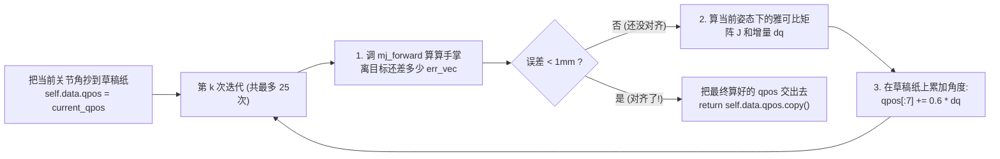

最近有一些工作对于之前的视觉任务有要求，因此现在我又回来重新学习一下基础的标定方法了。记录笔记来应对后续的工作。

机械臂手眼标定是机器人领域中的一个基础且关键的技术环节。简单来说，它的目标是确定机械臂与相机（眼睛）之间的坐标变换关系。手眼标定要解决的问题就是：让大脑（控制系统）知道眼睛看到的物体，相对于手（机械臂末端）在什么位置，这样手才能准确地抓取或操作物体。机械臂手眼标定一般分两种形式，一种是眼在手上，一种是眼在手外


机械臂系统里，存在以下4个坐标系，分别是机械臂基座坐标系、机械臂夹爪坐标系、相机坐标系、标定板坐标系。

## 眼在手上

眼在手上的模型下，相机固定在机械臂的末端，标定板固定在地面，机械臂带着相机从不同的角度对这标定板拍照，目的是标定出相机坐标系和夹爪坐标系间的关系。

它的特点有：

- 标定时标定板固定不动
- 标定板和机械臂基座之间相对静止，存在固定的转换关系
- 相机和夹爪之间相对静止，存在固定的关系
- 每次拍照，相机和标定板之间相对位置都会变化，但是可以通过opencv库计算出两者相对位置关系
- 每次拍照机械臂末端与基座的相对位置会变化，但是可以通过示教器读取两者相对位置关系


这个图片表示了机械臂在两个位置之间拍摄标定板的情况：

*   ${}^{b}T_{g}^{(i)}$ 和 ${}^{b}T_{g}^{(j)}$：机械臂在位置 \(i\) 和 \(j\) 时的正运动学解（已知）。
*   ${}^{g}T_{c}$：夹爪到相机的变换矩阵（**待求未知量**）。
*   ${}^{c}T_{t}^{(i)}$ 和 ${}^{c}T_{t}^{(j)}$：相机测得的到标定板的变换矩阵（已知）。
*   ${}^{b}T_{t}$：基座到标定板的变换矩阵（**固定常量**）。

这个是运动学里的符号表示法，T是变换矩阵，是M4的矩形，只要把T乘在一个坐标点上就可以进行刚体变换，左上标是起点，右下标是终点。

**bTg​**：读作“从 b 到 g 的变换”。b是机械臂底座，g是机械臂末端夹爪，从底座看，机械臂末端在哪里？这个数据由机械臂内部的电机编码器算出来（正运动学），是**已知量**。
**gTc​**：从 g（夹爪）到 c（相机 Camera），相机相对于夹爪装在哪？（手眼关系）。这是我们要**求的未知量**。
**cTt​**：从 c（相机）到 t（靶标 Target/标定板），相机拍到了标定板，标定板相对相机在哪？通过图像处理算法算出来，是**已知量**。


**路径 \(i\) 的变换：**

$$
{}^{b}T_{t} = {}^{b}T_{g}^{(i)} \cdot {}^{g}T_{c} \cdot {}^{c}T_{t}^{(i)}
$$

**路径 \(j\) 的变换：**

$$
{}^{b}T_{t} = {}^{b}T_{g}^{(j)} \cdot {}^{g}T_{c} \cdot {}^{c}T_{t}^{(j)}
$$

---


所以将两式联立：

$$
{}^{b}T_{g}^{(i)} \cdot {}^{g}T_{c} \cdot {}^{c}T_{t}^{(i)} = {}^{b}T_{g}^{(j)} \cdot {}^{g}T_{c} \cdot {}^{c}T_{t}^{(j)}
$$

**定义已知矩阵 \(A\) 和 \(B\)，以及未知矩阵 \(X\)：**

$$
A = ({}^{b}T_{g}^{(j)})^{-1} \cdot {}^{b}T_{g}^{(i)}
$$

$$
B = {}^{c}T_{t}^{(j)} \cdot ({}^{c}T_{t}^{(i)})^{-1}
$$

$$
X = {}^{g}T_{c}
$$

**最终方程：**

$$
A \cdot X = X \cdot B
$$

我们的终极目标就是求解出gTc，因为 gTc​ 是一个**常量**（只要相机不拆下来，它的位置就不会变），我们利用了“机械臂基座 b”和“标定板 t”也是固定的这一物理事实（闭环原理）。

我们让机械臂随便动两个姿势 i 和 j：因为终点都是固定的标定板，所以这两条路径相乘的结果必须相等。于是我们构建了方程：  **AX=XB** （这里的 X 就是我们要找的 gTc​） 。

实际标定时，我们会让机械臂**变换十几个甚至几十个姿态**（比如摇摆、平移、俯仰），拍几十张图。

### 仿真

仿真上，对于我们windows用户，这里推荐使用docker进行开发和仿真。我们选择用ubiagni/mujoco_ros:jazzy-ci_ros2 这个镜像，这个镜像预装了 **MuJoCo** 和 **ROS 1/2** 的完整环境。提供了 `ros1`、`ros2` (Humble/Jazzy) 等多个版本标签。

我们将通过viser来进行演示，这个十分的方便，还可以很好地通过页面的控件来控制机械臂，大概效果如下：


### 发布者侧

我们需要去写一个py去发布几个话题以及接受关节信息调整机械臂位姿：

```python
import os
import sys
import rclpy
from rclpy.node import Node
from sensor_msgs.msg import Image, JointState
from geometry_msgs.msg import PoseStamped
from cv_bridge import CvBridge

sys.path.insert(0, os.path.dirname(os.path.abspath(__file__)))
from utils import config, MujocoSimEngine


class MujocoRos2Bridge(Node):
    """
    纯粹的 ROS 2 仿真桥接层（不包含任何底层 MuJoCo 物理计算细节）：
    - 向下：持有 MujocoSimEngine 仿真内核实例
    - 向上：暴露 ROS 2 标准话题接口（接收 /joint_commands，发布 /camera/image_raw、/joint_states、/end_effector_pose）
    """

    def __init__(self):
        super().__init__('mujoco_sim_bridge')

        # 实例化纯 MuJoCo 仿真内核 (utils/mujoco_sim_engine.py)
        self.sim_engine = MujocoSimEngine(xml_path=config.SCENE_XML_PATH)

        # 初始化 ROS 2 话题发布者与订阅者
        self.image_pub = self.create_publisher(Image, '/camera/image_raw', 10)
        self.joint_pub = self.create_publisher(JointState, '/joint_states', 10)
        self.pose_pub = self.create_publisher(PoseStamped, '/end_effector_pose', 10)
        self.joint_cmd_sub = self.create_subscription(
            JointState, '/joint_commands', self.joint_cmd_callback, 10
        )
        self.bridge = CvBridge()

        # 30Hz 定时触发仿真步进与状态广播
        self.timer = self.create_timer(1.0 / 30.0, self.timer_callback)
        self.get_logger().info("MuJoCo ROS 2 仿真桥接节点 (MujocoRos2Bridge) 已启动！")

    def joint_cmd_callback(self, msg: JointState):
        """ROS 2 订阅回调：直接将关节控制指令转发给仿真内核"""
        self.sim_engine.apply_joint_command(msg.position)

    def timer_callback(self):
        """ROS 2 定时发布回调：从仿真内核读取最新一帧状态并打包为 ROS 2 消息广播"""
        bgr_image, qpos_list, ee_pos, ee_quat = self.sim_engine.step_and_render()
        stamp = self.get_clock().now().to_msg()

        # 发布手眼相机图像 (/camera/image_raw)
        img_msg = self.bridge.cv2_to_imgmsg(bgr_image, encoding="bgr8")
        img_msg.header.stamp = stamp
        img_msg.header.frame_id = config.CAMERA_NAME
        self.image_pub.publish(img_msg)

        # 发布广义关节与场景物体状态 (/joint_states)
        joint_msg = JointState()
        joint_msg.header.stamp = stamp
        joint_msg.position = qpos_list
        self.joint_pub.publish(joint_msg)

        # 发布机械臂末端位姿 (/end_effector_pose)
        pose_msg = PoseStamped()
        pose_msg.header.stamp = stamp
        pose_msg.header.frame_id = "base_link"
        pose_msg.pose.position.x = float(ee_pos[0])
        pose_msg.pose.position.y = float(ee_pos[1])
        pose_msg.pose.position.z = float(ee_pos[2])
        pose_msg.pose.orientation.w = float(ee_quat[0])
        pose_msg.pose.orientation.x = float(ee_quat[1])
        pose_msg.pose.orientation.y = float(ee_quat[2])
        pose_msg.pose.orientation.z = float(ee_quat[3])
        self.pose_pub.publish(pose_msg)


def main(args=None):
    rclpy.init(args=args)
    node = MujocoRos2Bridge()
    try:
        rclpy.spin(node)
    except KeyboardInterrupt:
        pass
    finally:
        node.destroy_node()
        rclpy.shutdown()


if __name__ == '__main__':
    main()
```

我们使用命令：ros2 interface show sensor_msgs/msg/Image 就可以查看出实际上的消息模型结构：

```shell
root@33dfe77d2804:/home/ros2_ws/src/mujoco_menagerie/franka_emika_panda# ros2 interface show sensor_msgs/msg/Image
# This message contains an uncompressed image
# (0, 0) is at top-left corner of image

std_msgs/Header header # Header timestamp should be acquisition time of image
        builtin_interfaces/Time stamp
                int32 sec
                uint32 nanosec
        string frame_id
                             # Header frame_id should be optical frame of camera
                             # origin of frame should be optical center of cameara
                             # +x should point to the right in the image
                             # +y should point down in the image
                             # +z should point into to plane of the image
                             # If the frame_id here and the frame_id of the CameraInfo
                             # message associated with the image conflict
                             # the behavior is undefined

uint32 height                # image height, that is, number of rows
uint32 width                 # image width, that is, number of columns

# The legal values for encoding are in file include/sensor_msgs/image_encodings.hpp
# If you want to standardize a new string format, join
# ros-users@lists.ros.org and send an email proposing a new encoding.

string encoding       # Encoding of pixels -- channel meaning, ordering, size
                      # taken from the list of strings in include/sensor_msgs/image_encodings.hpp

uint8 is_bigendian    # is this data bigendian?
uint32 step           # Full row length in bytes
uint8[] data          # actual matrix data, size is (step * rows)
```

因此就是这样：

```shell
std_msgs/Header header          # 消息头
builtin_interfaces/Time stamp   # 时间戳 (sec, nanosec)
string frame_id                 # 坐标系名称 -> 我们填了 "hand_camera"
uint32 height                   # 图像高度 (行数) -> 480
uint32 width                    # 图像宽度 (列数) -> 640
string encoding                 # 像素编码格式 -> "bgr8" (蓝绿红三通道，每通道8位)
uint8 is_bigendian              # 字节序 -> 0 (小端序)
uint32 step                     # 一行像素占用的字节数 -> 640 * 3 = 1920 字节
uint8[] data                    # 展平的一维原始像素字节数组 (长度 = 480 * 1920 = 921,600 字节)
```

由于MuJoCo 的 self.renderer.render() 渲染出来的是 (480, 640, 3) 的 RGB NumPy 数组我们在这里需要使用`rgb_image[:, :, ::-1]` 转成 OpenCV 标准的 BGR 顺序，再通过CvBridge.cv2_to_imgmsg(..., encoding="bgr8") 打包成上面的 Image 消息结构。

为了能够让订阅的节点可以接受到关节信息，我们定义了/joint_states 与 /joint_commands。

消息类型：sensor_msgs/msg/JointState：

```shell
root@33dfe77d2804:/home/ros2_ws/src/mujoco_menagerie/franka_emika_panda# ros2 interface show sensor_msgs/msg/JointState
# This is a message that holds data to describe the state of a set of torque controlled joints.
#
# The state of each joint (revolute or prismatic) is defined by:
#  * the position of the joint (rad or m),
#  * the velocity of the joint (rad/s or m/s) and
#  * the effort that is applied in the joint (Nm or N).
#
# Each joint is uniquely identified by its name
# The header specifies the time at which the joint states were recorded. All the joint states
# in one message have to be recorded at the same time.
#
# This message consists of a multiple arrays, one for each part of the joint state.
# The goal is to make each of the fields optional. When e.g. your joints have no
# effort associated with them, you can leave the effort array empty.
#
# All arrays in this message should have the same size, or be empty.
# This is the only way to uniquely associate the joint name with the correct
# states.

std_msgs/Header header
        builtin_interfaces/Time stamp
                int32 sec
                uint32 nanosec
        string frame_id

string[] name
float64[] position
float64[] velocity
float64[] effort
root@33dfe77d2804:/home/ros2_ws/src/mujoco_menagerie/franka_emika_panda# 
```

大致如下：

```shell
std_msgs/Header header
builtin_interfaces/Time stamp
string frame_id
string[] name                   # 关节名称数组 (可选)
float64[] position              # 关节位置数组 (单位: 旋转关节为 rad, 移动关节为 m)
float64[] velocity              # 关节速度数组 (可选)
float64[] effort                # 关节力矩/推力数组 (可选)
```


在添加了带 <freejoint/> 的 ArUco 立方体后，MuJoCo 的广义坐标 qpos 一共有 16 个 float64 浮点数，我们在 JointState.position 中按如下索引传递：

position的从0到7是panda机械臂的joint1 ~ joint7，含有7个旋转关节角度。position的8-9两维度对应夹爪的左右指 finger_joint1、finger_joint2。position的10到12共三维是aruco立方体aruco_cube_0的位置，立方体在世界坐标系下的三维坐标 `[x, y,z]`（单位：米 m，初始为 `[0.35, 0.21, 0.025]`）。13到16共四维度是aruco_cube_0的姿态，立方体的三维旋转四元数 `[w, x, y, z]`（MuJoCo约定实部 w 在前，初始为 `[1, 0, 0, 0]`）。

这一个qpos 的16维度的float64浮点数就可以表示出来从机械臂到夹爪再到立方体的所有信息。

机械臂末端三维位姿话题：/end_effector_pose，消息类型是geometry_msgs/msg/PoseStamped。

```shell
root@33dfe77d2804:/home/ros2_ws/src/mujoco_menagerie/franka_emika_panda# ros2 interface show 
geometry_msgs/msg/PoseStamped
# A Pose with reference coordinate frame and timestamp

std_msgs/Header header
        builtin_interfaces/Time stamp
                int32 sec
                uint32 nanosec
        string frame_id
Pose pose
        Point position
                float64 x
                float64 y
                float64 z
        Quaternion orientation
                float64 x 0
                float64 y 0
                float64 z 0
                float64 w 1
root@33dfe77d2804:/home/ros2_ws/src/mujoco_menagerie/franka_emika_panda# 


```

大致为：

```shell
std_msgs/Header header
builtin_interfaces/Time stamp
string frame_id               # 参考坐标系 -> "base_link" (即机械臂基座世界坐标系)
geometry_msgs/Pose pose
geometry_msgs/Point position  # 末端 (hand 刚体原点) 的三维坐标 (单位: m)
float64 x                   # -> float(pos[0])
float64 y                   # -> float(pos[1])
float64 z                   # -> float(pos[2])
geometry_msgs/Quaternion orientation # 末端的旋转四元数
float64 x                   # -> float(quat[1])  注意：MuJoCo 的xquat 顺序是 [w, x, y, z]
float64 y                   # -> float(quat[2])
float64 z                   # -> float(quat[3])
float64 w                   # -> float(quat[0])
```

注意四元数顺序差异：

>MuJoCo 内部（data.body(ee_id).xquat） 与 Viser（wxyz） 都是 `[w, x, y, z]` 顺序（所以 `quat[0]` 是 w）；而 ROS 2 的 geometry_msgs/Quaternion 字段名是 Explicit 的 .x, .y, .z, .w，所以我们需要专门做`orientation.w = quat[0], orientation.x = quat[1]` 的一一对应赋值。

我们可以把config的配置拿出来细品就可以看出初始化的方法：

```python
import os
import numpy as np

# 模型与路径配置
SCENE_XML_PATH = "/home/ros2_ws/src/mujoco_menagerie/franka_emika_panda/scene.xml"
CALIB_DATA_DIR = os.path.join(
    os.path.dirname(os.path.dirname(os.path.abspath(__file__))), "calib_data"
)

# 相机渲染与内参配置 (640x480, fovy=60°)
CAMERA_NAME = "hand_camera"
CAM_WIDTH = 640
CAM_HEIGHT = 480
CAM_FOVY_DEG = 60.0
_FY = (CAM_HEIGHT / 2.0) / np.tan(np.deg2rad(CAM_FOVY_DEG / 2.0))
CAMERA_MATRIX = np.array(
    [
        [_FY, 0.0, CAM_WIDTH / 2.0],
        [0.0, _FY, CAM_HEIGHT / 2.0],
        [0.0, 0.0, 1.0],
    ],
    dtype=np.float64,
)
DIST_COEFFS = np.zeros((5, 1), dtype=np.float64)

# 机械臂几何与预设关节姿态配置
EE_BODY_NAME = "hand"
# 夹爪指尖夹持中心相对于 hand 刚体原点的局部偏移 (m)
FINGERTIP_LOCAL_OFFSET = np.array([0.0, 0.0, 0.103], dtype=np.float64)
# 末端垂直朝下时的目标姿态四元数 (绕 X 轴旋转 180°: w=0, x=1, y=0, z=0)
DOWNWARD_WXYZ = np.array([0.0, 1.0, 0.0, 0.0], dtype=np.float64)

HOME_QPOS = [0.0, -0.785, 0.0, -2.356, 0.0, 1.571, 0.785, 0.04, 0.04]
HIGH_VIEW_QPOS = [0.0, -0.45, 0.0, -1.85, 0.0, 1.40, 0.785, 0.04, 0.04]
LOW_VIEW_QPOS = [0.0, -0.35, 0.0, -2.55, 0.0, 2.20, 0.785, 0.04, 0.04]

# 手眼标定棋盘格与真值配置
CHESSBOARD_PATTERN_SIZE = (7, 5)  # 内角点行列数 (7x5=35)
CHESSBOARD_SQUARE_SIZE = 0.03     # 单格边长 3cm
GT_T_CAM2GRIPPER = np.array([0.050, 0.000, 0.040], dtype=np.float64)
GT_R_CAM2GRIPPER = np.eye(3, dtype=np.float64)

# ArUco 立方体配置
ARUCO_MARKER_SIZE = 0.048         # 立方体顶面 ArUco 码边长 4.8cm
CUBE_HALF_HEIGHT = 0.025          # 立方体半高 2.5cm
CUBE_INIT_POS = [0.35, 0.21, 0.025]

```

`HOME_QPOS = [0.0, -0.785, 0.0, -2.356, 0.0, 1.571, 0.785, 0.04, 0.04]`  
这 9 个数字直接对应 MuJoCo 模型里的关节自由度，我们知道前7个表示旋转关节角度，单位为弧度，后2个事夹爪的两个平行手指的滑动位移，0.04表示张开4cm。

**`self.data.ctrl[7] = 255.0`**：这是给夹爪执行器（Actuator）发送的控制指令，`255.0` 在 MuJoCo 中通常是让夹爪保持最大力度的张开或闭合状态。

在 3D 空间里，用欧拉角描述姿态容易出现“万向节死锁”，而四元数（`w, x, y, z`）是最平滑、计算最稳定的姿态表示法。
```
# 末端垂直朝下时的目标姿态四元数 (绕 X 轴旋转 180°: w=0, x=1, y=0, z=0)
DOWNWARD_WXYZ = np.array([0.0, 1.0, 0.0, 0.0], dtype=np.float64)
```
这里 `[0, 1, 0, 0]` 代表将夹爪旋转到垂直向下。这个四元数不会直接塞进 `qpos`，而是在你后续做**运动规划**（比如计算目标末端位姿 Ttarget​）或者**逆运动学解算**（IK）时，作为目标矩阵的旋转部分使用的。

### 机械臂运控

由于我之前可以说完全没有接触过机械臂的运动控制，因此这里我会看代码看的很细致。我们知道，机械臂的有两个空间坐标系，一个叫做关节空间，是机械臂身上7个电机各自转了多少度；笛卡尔空间/末端空间事人类和相机关心的机械臂手掌在三维世界里的 xyz 坐标和朝向四元数数组wxyz。

所以，我们会在controller内完成两个纯算法，kinematics_ik.py是已知手掌，想去xyz的话，算出7个电机该转动多少度。trajectory_planner.py是动作编导，把一段长路径给切成几十个平滑的小步，每一步调用去算出电机角度。

kinematics_ik.py里会有正向运动学我们叫做FK，还有逆向运动学我们叫做IK。

```python
import mujoco
import numpy as np


class PandaIKSolver:
    """基于阻尼最小二乘雅可比矩阵 (Damped Least-Squares Jacobian) 的 Panda 机械臂逆运动学求解器"""

    def __init__(self, mj_model: mujoco.MjModel, ee_body_name: str = "hand"):
        self.model = mj_model
        self.data = mujoco.MjData(mj_model)
        self.ee_id = mujoco.mj_name2id(
            self.model, mujoco.mjtObj.mjOBJ_BODY, ee_body_name
        )
        # Panda 前 7 个关节的上下限
        self.jnt_min = self.model.jnt_range[:7, 0].copy()
        self.jnt_max = self.model.jnt_range[:7, 1].copy()

    def get_ee_pose(self, qpos: np.ndarray) -> tuple[np.ndarray, np.ndarray]:
        """给定关节角 qpos，计算末端 (hand) 的世界坐标 position 与四元数 wxyz"""
        self.data.qpos[: len(qpos)] = qpos
        mujoco.mj_forward(self.model, self.data)
        pos = self.data.xpos[self.ee_id].copy()
        wxyz = self.data.xquat[self.ee_id].copy()
        return pos, wxyz

    def solve_ik(
        self,
        target_pos: np.ndarray,
        target_wxyz: np.ndarray,
        current_qpos: np.ndarray,
        max_iters: int = 25,
        tol: float = 1e-3,
        damping: float = 0.05,
        step_size: float = 0.6,
    ) -> np.ndarray:
        """
        根据目标末端位置 target_pos (3,) 与四元数 target_wxyz (4, wxyz)
        迭代求解 Panda 7 自由度关节角，保持夹爪开合度不变。
        """
        self.data.qpos[: len(current_qpos)] = current_qpos
        jacp = np.zeros((3, self.model.nv))
        jacr = np.zeros((3, self.model.nv))
        err_vec = np.zeros(6)
        neg_cur_quat = np.zeros(4)
        err_quat = np.zeros(4)
        rot_err_world = np.zeros(3)

        target_wxyz = np.asarray(target_wxyz, dtype=np.float64)
        norm = np.linalg.norm(target_wxyz)
        if norm > 1e-8:
            target_wxyz = target_wxyz / norm

        for _ in range(max_iters):
            mujoco.mj_forward(self.model, self.data)
            cur_pos = self.data.xpos[self.ee_id]
            cur_quat = self.data.xquat[self.ee_id]

            # 位置误差 (世界坐标系)
            pos_err = target_pos - cur_pos

            # 姿态误差 (转为世界坐标系角速度方向误差)
            if np.dot(target_wxyz, cur_quat) < 0.0:
                target_wxyz = -target_wxyz
            mujoco.mju_negQuat(neg_cur_quat, cur_quat)
            mujoco.mju_mulQuat(err_quat, target_wxyz, neg_cur_quat)
            mujoco.mju_quat2Vel(rot_err_world, err_quat, 1.0)

            err_vec[:3] = pos_err
            err_vec[3:] = rot_err_world

            if np.linalg.norm(err_vec) < tol:
                break

            # 计算末端 6x7 雅可比矩阵并执行阻尼最小二乘更新
            mujoco.mj_jacBody(self.model, self.data, jacp, jacr, self.ee_id)
            J = np.vstack([jacp[:, :7], jacr[:, :7]])  # (6, 7)

            jjt = J @ J.T + (damping**2) * np.eye(6)
            dq = J.T @ np.linalg.solve(jjt, err_vec)

            self.data.qpos[:7] = np.clip(
                self.data.qpos[:7] + step_size * dq, self.jnt_min, self.jnt_max
            )

        return self.data.qpos.copy()
```

这里我们初始化了结构和关节限位：

```python
def __init__(self, mj_model: mujoco.MjModel, ee_body_name: str = "hand"):
	self.model = mj_model
	self.data = mujoco.MjData(mj_model)
	self.ee_id = mujoco.mj_name2id(
		self.model, mujoco.mjtObj.mjOBJ_BODY, ee_body_name
	)
	# Panda 前 7 个关节的上下限
	self.jnt_min = self.model.jnt_range[:7, 0].copy()
	self.jnt_max = self.model.jnt_range[:7, 1].copy()
```

ee_id是为了查出机械臂末端手掌“hand"在mujoco里的编号id。jnt_min/jnt_max可以读取panda机械臂7个关节的物理极限角度比如说手肘关节不能反折，防止算出来的角度把机械臂瓣断。

已知 7 个电机的角度 qpos，手掌现在在三维空间的哪儿，这个就是正向运动学要干的事。

```python
def get_ee_pose(self, qpos: np.ndarray) -> tuple[np.ndarray, np.ndarray]:
	"""给定关节角 qpos，计算末端 (hand) 的世界坐标 position 与四元数 wxyz"""
	self.data.qpos[: len(qpos)] = qpos
	mujoco.mj_forward(self.model, self.data)
	pos = self.data.xpos[self.ee_id].copy()
	wxyz = self.data.xquat[self.ee_id].copy()
	return pos, wxyz
```

`mujoco.mj_forward(self.model, self.data)` 让mujoco顺着连杆一节节地算出所有坐标。pos就是手掌的世界坐标xyz了，wxyz就是手掌的旋转四元数。

正运动学非常简单：把角度塞进 qpos，调一行 mj_forward，MuJoCo 就会顺着底座 → 大臂 → 小臂 → 手腕一路算出手掌的xpos 和 xquat。

逆运动学最核心的内容，solve_ik，我们想要让手掌去目标位置target位置和目标朝向target_wxyz，那么7个关节应该转动多少角度。因为7个关节通过复杂的三角函数耦合在了一起，是没法用一条公式算出答案的，所以工业界界最通用的做法是“小步试探逼近法”（雅可比迭代法，循环最多 25 次）。


```python

for _ in range(max_iters):
	mujoco.mj_forward(self.model, self.data)
	cur_pos = self.data.xpos[self.ee_id]
	cur_quat = self.data.xquat[self.ee_id]

	# 位置误差 (世界坐标系)
	pos_err = target_pos - cur_pos

	# 姿态误差 (转为世界坐标系角速度方向误差)
	if np.dot(target_wxyz, cur_quat) < 0.0:
		target_wxyz = -target_wxyz
	mujoco.mju_negQuat(neg_cur_quat, cur_quat)
	mujoco.mju_mulQuat(err_quat, target_wxyz, neg_cur_quat)
	mujoco.mju_quat2Vel(rot_err_world, err_quat, 1.0)

	err_vec[:3] = pos_err
	err_vec[3:] = rot_err_world

	if np.linalg.norm(err_vec) < tol:
		break
```

雅可比矩阵 $J$ 是一个数学桥梁，它把**关节的微小转动速度（q˙​）** 映射成了 **末端在空间中的微小运动速度（$[v,ω]$，即线速度和角速度）**：

假设机械臂当前有 7 个关节角度 $\mathbf{q} = [q_1, q_2, ..., q_7]$。雅可比矩阵 $\mathbf{J}$ 是一个数学桥梁，它把**关节的微小转动速度（$\dot{\mathbf{q}}$）** 映射成了 **末端在空间中的微小运动速度（$[v, \omega]$，即线速度和角速度）**：

$$
\begin{bmatrix} v \\ \omega \end{bmatrix} = \mathbf{J}(\mathbf{q}) \cdot \dot{\mathbf{q}}
$$

* $\mathbf{J}$ 的大小：末端有 6 个自由度（3个位置 + 3个姿态），关节有 7 个，所以 $\mathbf{J}$ 是一个 **$6 \times 7$ 的矩阵**
* $\mathbf{J}$ 的每一列，代表了某个特定关节转动时，末端会产生怎样的运动

一个机械臂如果有7个旋转关节，那么q就是一个7x1的列向量，表示当前7个关节的角度，q˙​ 就是7个关节的角速度，是微小的转动速度。 这样计算出来， 一个6x7的矩阵左乘以一个6x1的列向量，得到的$[v, \omega]$就是一个6x1向量，这样就把7维的关节空间，映射到了6维的物理空间。

传统的工业机械臂（如 UR5、KUKA）通常是 **6 个关节**，刚好满足空间中的 6 个自由度（3个位置 + 3个姿态），这叫“非冗余”机械臂。PANDA机械臂有7个关节，多出来的叫做冗余自由度，对于同一个目标位置和姿态，Panda 有**无数种**关节角度的组合方式可以到达。

根据上面的代码可知，这里IK我摸带入了位置误差和姿态误差，因为在雅可比迭代法中，必须同时把位置误差和姿态误差组成一个6x1的向量e带入计算，我们需要让夹爪移动到方块上方，还要让夹爪可以调整角度向下抓取，所以末端有6个自由度，3平移3旋转，因此雅可比矩阵J是6x7的，误差向量e是6x1的。

$$
\begin{bmatrix} e_p \\ e_o \end{bmatrix}_{6 \times 1} = \mathbf{J}_{6 \times 7} \cdot \Delta\mathbf{q}_{7 \times 1}
$$

这里得出的ep eo就是我们说的6dof，经典6自由度概念，ep是三维平移误差，对应xyz三个轴上的距离差，单位通常是米，eo是三维旋转误差，对应绕xyz三个轴旋转的角度差，单位通常是弧度。

$$
\begin{bmatrix} e_p \\ e_o \end{bmatrix} = \begin{bmatrix} p_{target} - p_{current} \\ \text{RotVec}(R_{target} \cdot R_{current}^T) \end{bmatrix}
$$

代码里：

```python
pos_err = target_pos - cur_pos  # 位置还差多少米 (3维: dx, dy, dz)
...
err_vec[:3] = pos_err
err_vec[3:] = rot_err_world     # 姿态还差多少弧度 (3维: 绕 X, Y, Z 轴的旋转差)
```

如果总误差 `np.linalg.norm(err_vec) < tol`（小于 1 毫米），说明已经到位了，直接 break。

我们的雅可比矩阵从mujoco里得到，**`mj_jacBody`**：这是 MuJoCo 提供的高级 API，我们只需要提供想要哪个body比如说hand，他就会在后台根据当前所有关节角度，通过接下算出body的雅可比矩阵。mujoco吧雅可比分为两部分，jacp和jacr，前者是3 x nv 的位置雅可比，后者是jacr的 3 x nv 的姿态雅可比。

```python
mujoco.mj_jacBody(self.model, self.data, jacp, jacr, self.ee_id)
J = np.vstack([jacp[:, :7], jacr[:, :7]])  # 形状为 (6, 7) 的矩阵
```

然后通过阻尼最小二乘反推每个点击该转动多少度，代码用`np.linalg.solve(jjt, err_vec)` 求解线性方程组，而不是 `np.linalg.inv(jjt)` 求逆矩阵。在计算数学里，`solve` 速度更快、数值更稳定，不会因为矩阵接近奇异而崩溃。并且这里还做了步长控制和关节限位：

**`step_size = 0.6`**：每次迭代只走理论计算值的 60%
**`np.clip`** 能够保证关节角不超过机械臂的物理限位

```python
jjt = J @ J.T + (damping**2) * np.eye(6)
dq = J.T @ np.linalg.solve(jjt, err_vec)

self.data.qpos[:7] = np.clip(
	self.data.qpos[:7] + step_size * dq, self.jnt_min, self.jnt_max
)
```

它完美实现了公式：$\Delta q = J^T (J J^T + \lambda^2 I)^{-1} e$ ，我们就成功求出了微小增量的步长，在个循环里，dq只要算出来了就直接加到qpos这个关节角上，变成了新的位置。




内部的ik迭代频率非常快，这个for循环最多25次是瞬间的事情，估计只会耗时几ms的样子，他会迭代到误差小于1mm，就会把最终的那组qpos直接return出来。

拿到了这组qpos之后，需要真正发给机械臂执行，我们在仿真里的外部控制频率是30hz，间隔33.3ms。之后我们可以使用电机驱动法，让机械臂能够平滑地移动过去。

### 抓取任务调用ik_sovle

在抓取的任务当中，run_cartesian_segment方法就调用了ik_solver来求解q，分成了steps布，每一步都会调用一次solve_ik，算出终点的关节角q_end，然后直接让 7 个关节从q_start 走到 q_end。
```python
def run_cartesian_segment(
        self,
        q_start: np.ndarray,
        start_pos: np.ndarray,
        start_wxyz: np.ndarray,
        end_pos: np.ndarray,
        end_wxyz: np.ndarray,
        end_gripper: float,
        duration: float,
        on_step_qpos: Callable[[np.ndarray], None],
        hz: int = 30,
    ) -> np.ndarray:
        """
        从当前真实位姿 (start_pos, start_wxyz, q_start[7]) 平滑插值到目标位姿 (end_pos, end_wxyz, end_gripper)
        """
        steps = max(2, int(duration * hz))
        q = q_start.copy()
        start_gripper = float(q[7]) if len(q) >= 8 else end_gripper
        dt = 1.0 / float(hz)

        for step in range(1, steps + 1):
        
	        # 计算平滑时间进度 tau
            tau = self.quintic_time_scaling(step / float(steps)) 
            
            # 算出当前这 1/30 秒的“微元目标位姿”
            waypoint_pos = (1.0 - tau) * start_pos + tau * end_pos
            waypoint_wxyz = self.quat_slerp(start_wxyz, end_wxyz, tau)
            gripper_val = (1.0 - tau) * start_gripper + tau * end_gripper

			# 调用 solve_ik 把微元 3D 位姿变成 7 个关节角
            q_ik = self.ik_solver.solve_ik(
                waypoint_pos, waypoint_wxyz, q[:9], max_iters=25, tol=5e-4
            )
            
            q[:7] = q_ik[:7]
            q[7] = gripper_val
            q[8] = gripper_val

            on_step_qpos(q.copy())
            time.sleep(dt)

        return q
```

>`q_ik = self.ik_solver.solve_ik(`
        `waypoint_pos, waypoint_wxyz, q[:9], max_iters=25, tol=5e-4`
    `)` 这里传入的第三个参数   `q[:9]` 是上一小步算出来的关节角，这在机器人学里叫做 热启动

如果只对终点算一次ik，7 个旋转关节各自匀速转动，机械臂末端在 3D空间里画出来的一定是一条弯曲的圆弧线！在阶段2（垂直下降抓方块）时，如果走圆弧线，手指在下落中途就会从侧面把桌面上的方块撞飞。在 run_cartesian_segment 中每步调一次 IK（笛卡尔空间直线插值）就可以解决。

### 让机械臂防止走圆弧线

我们在3d空间里把起点 start_pos 到终点 end_pos 连一条笔直的线段按 30Hz（假设 duration=1.0s，就是steps=30 个微小路点）切碎。每一个路点都强制调用一次solve_ik，逼着机械臂末端严格沿着空间直线（例如笔直往下落、笔直往上提）运动。

机械臂的 7 个关节全都是旋转合页，没有一个是直上直下的，思考一下人的身体，你怎么画出直线的，因为当你的肩膀往下转的同时，你的手肘在以一种快慢不断变化的非线性速度往回缩，把向外鼓出的那部分圆弧刚好抵消掉。

代码里的切分就是类似原理，将原本可能弧线的路径给切了30次，这样就近似于一个直线路径了，这样就可以很不错地实现平滑的移动了，因为你规定了路径了，末端就会强制这样走。

<svg xmlns="http://www.w3.org/2000/svg" viewBox="0 0 800 500" width="100%" height="100%">
  <defs>
    <!-- 箭头定义 -->
    <marker id="arrow-up" viewBox="0 0 10 10" refX="5" refY="5" markerWidth="6" markerHeight="6" orient="auto-start-reverse">
      <path d="M 0 10 L 5 0 L 10 10 z" fill="#2c3e50" />
    </marker>
    <marker id="arrow-down" viewBox="0 0 10 10" refX="5" refY="5" markerWidth="6" markerHeight="6" orient="auto-start-reverse">
      <path d="M 0 10 L 5 0 L 10 10 z" fill="#e74c3c" />
    </marker>
    <marker id="arrow-green" viewBox="0 0 10 10" refX="5" refY="5" markerWidth="6" markerHeight="6" orient="auto-start-reverse">
      <path d="M 0 10 L 5 0 L 10 10 z" fill="#27ae60" />
    </marker>
    <filter id="shadow" x="-10%" y="-10%" width="120%" height="120%">
      <feDropShadow dx="2" dy="4" stdDeviation="3" flood-opacity="0.1"/>
    </filter>
  </defs>

  <!-- 背景 -->
  <rect width="100%" height="100%" fill="#f8f9fa" rx="10"/>

  <!-- 全局坐标轴 -->
  <line x1="50" y1="420" x2="750" y2="420" stroke="#bdc3c7" stroke-width="2" marker-end="url(#arrow-up)"/>
  <text x="760" y="425" font-family="sans-serif" font-size="14" fill="#7f8c8d">X</text>
  <line x1="50" y1="420" x2="50" y2="50" stroke="#bdc3c7" stroke-width="2" marker-end="url(#arrow-up)"/>
  <text x="40" y="40" font-family="sans-serif" font-size="14" fill="#7f8c8d">Z</text>

  <!-- ================= 左侧：未切分（圆弧） ================= -->
  <g transform="translate(0, 0)">
    <!-- 标题 -->
    <text x="250" y="60" font-family="sans-serif" font-size="18" font-weight="bold" fill="#e74c3c" text-anchor="middle">情况一：仅算起终点（未切分）</text>
    
    <!-- 机械臂底座 -->
    <circle cx="100" cy="380" r="15" fill="#34495e" />
    <text x="100" y="415" font-family="sans-serif" font-size="12" fill="#34495e" text-anchor="middle">基座</text>

    <!-- 起点姿态（简笔画） -->
    <line x1="100" y1="380" x2="220" y2="180" stroke="#95a5a6" stroke-width="6" stroke-linecap="round"/>
    <line x1="220" y1="180" x2="250" y2="260" stroke="#95a5a6" stroke-width="4" stroke-linecap="round"/>
    <!-- 终点姿态 -->
    <line x1="100" y1="380" x2="250" y2="280" stroke="#bdc3c7" stroke-width="6" stroke-linecap="round" stroke-dasharray="5,5"/>
    <line x1="250" y1="280" x2="250" y2="350" stroke="#bdc3c7" stroke-width="4" stroke-linecap="round" stroke-dasharray="5,5"/>

    <!-- 红色圆弧轨迹 -->
    <path d="M 250 260 Q 330 300 250 350" fill="none" stroke="#e74c3c" stroke-width="3" stroke-dasharray="8,4" marker-end="url(#arrow-down)"/>
    
    <!-- 标记点 -->
    <circle cx="250" cy="260" r="6" fill="#2c3e50"/>
    <text x="260" y="250" font-family="sans-serif" font-size="12" fill="#2c3e50">起点 [X=0.35, Z=0.27]</text>
    
    <circle cx="310" cy="305" r="6" fill="#e74c3c"/>
    <text x="320" y="300" font-family="sans-serif" font-size="12" fill="#e74c3c">半路跑偏 [X=0.39]</text>

    <circle cx="250" cy="350" r="6" fill="#2c3e50"/>
    <text x="260" y="370" font-family="sans-serif" font-size="12" fill="#2c3e50">终点 [X=0.35, Z=0.13]</text>
    
    <!-- 说明文字 -->
    <text x="250" y="460" font-family="sans-serif" font-size="14" fill="#7f8c8d" text-anchor="middle">肩膀和手肘各自匀速转，手掌在空中划出圆弧</text>
  </g>

  <!-- 分割线 -->
  <line x1="400" y1="80" x2="400" y2="450" stroke="#ecf0f1" stroke-width="4"/>

  <!-- ================= 右侧：切分30次 + IK（直线） ================= -->
  <g transform="translate(0, 0)">
    <!-- 标题 -->
    <text x="600" y="60" font-family="sans-serif" font-size="18" font-weight="bold" fill="#27ae60" text-anchor="middle">情况二：切分 30 次 + IK 求解</text>

    <!-- 机械臂底座 -->
    <circle cx="450" cy="380" r="15" fill="#34495e" />
    <text x="450" y="415" font-family="sans-serif" font-size="12" fill="#34495e" text-anchor="middle">基座</text>

    <!-- 起点姿态 -->
    <line x1="450" y1="380" x2="570" y2="180" stroke="#bdc3c7" stroke-width="6" stroke-linecap="round"/>
    <line x1="570" y1="180" x2="600" y2="260" stroke="#bdc3c7" stroke-width="4" stroke-linecap="round"/>
    
    <!-- 中间某个姿态（展示手肘修正） -->
    <line x1="450" y1="380" x2="560" y2="230" stroke="#95a5a6" stroke-width="6" stroke-linecap="round"/>
    <line x1="560" y1="230" x2="600" y2="305" stroke="#95a5a6" stroke-width="4" stroke-linecap="round"/>
    
    <!-- 终点姿态 -->
    <line x1="450" y1="380" x2="550" y2="280" stroke="#bdc3c7" stroke-width="6" stroke-linecap="round"/>
    <line x1="550" y1="280" x2="600" y2="350" stroke="#bdc3c7" stroke-width="4" stroke-linecap="round"/>

    <!-- 绿色直线轨迹 -->
    <line x1="600" y1="260" x2="600" y2="350" stroke="#27ae60" stroke-width="4" marker-end="url(#arrow-green)"/>
    
    <!-- 切分的点（示意画 8 个点，代表 30 个） -->
    <circle cx="600" cy="260" r="5" fill="#27ae60"/>
    <circle cx="600" cy="273" r="4" fill="#27ae60"/>
    <circle cx="600" cy="286" r="4" fill="#27ae60"/>
    <circle cx="600" cy="299" r="4" fill="#27ae60"/>
    <circle cx="600" cy="312" r="4" fill="#27ae60"/>
    <circle cx="600" cy="325" r="4" fill="#27ae60"/>
    <circle cx="600" cy="338" r="4" fill="#27ae60"/>
    <circle cx="600" cy="350" r="5" fill="#27ae60"/>

    <!-- 标记点 -->
    <text x="610" y="250" font-family="sans-serif" font-size="12" fill="#2c3e50">起点 [X=0.35, Z=0.27]</text>
    <text x="610" y="370" font-family="sans-serif" font-size="12" fill="#2c3e50">终点 [X=0.35, Z=0.13]</text>

    <!-- 说明标注 -->
    <text x="620" y="280" font-family="sans-serif" font-size="13" fill="#27ae60" font-weight="bold">钉入 waypoints</text>
    <text x="620" y="300" font-family="monospace" font-size="12" fill="#27ae60">每次降 4mm</text>
    <text x="620" y="320" font-family="sans-serif" font-size="13" fill="#27ae60" font-weight="bold">IK 强制修正 X=0.35</text>

    <!-- 说明文字 -->
    <text x="600" y="460" font-family="sans-serif" font-size="14" fill="#7f8c8d" text-anchor="middle">30 颗紧挨着的钉子穿在一起，宏观就是完美的直线</text>
  </g>

  <!-- 底部注释 -->
  <rect x="150" y="475" width="500" height="30" rx="15" fill="#ecf0f1"/>
  <text x="400" y="495" font-family="sans-serif" font-size="14" fill="#34495e" text-anchor="middle">原理：手肘的非线性收缩，刚好抵消了肩膀旋转带来的圆弧向外鼓出！</text>

</svg>

### 仿真器里的流程

在仿真中， aruco_detector.py的joint_callback中接受到真实的jointState之后同步到viser上：

```python
def joint_callback(self, msg: JointState):
	"""接收仿真端 PD 物理引擎发布的真实 /joint_states 并同步 Viser 3D 场景"""
	n = min(len(msg.position), self.mj_model.nq)
	if n == 0:
		return
	new_qpos = np.array(msg.position[:n], dtype=np.float64)

	with self._mj_lock:
		# 操控期间手臂前 7 轴使用本地低延迟预览，但始终实时同步物理引擎算出的夹爪与方块真实位置 (index 7..16)！
		if time.monotonic() - self._last_user_cmd_time < 0.25:
			if n >= 16:
				self.mj_data.qpos[7:16] = new_qpos[7:16]
				mujoco.mj_forward(self.mj_model, self.mj_data)
				self.viser_scene.update_scene_poses()
			return

		if np.allclose(self.mj_data.qpos[:n], new_qpos, atol=1e-4):
			return
		self.mj_data.qpos[:n] = new_qpos
		mujoco.mj_forward(self.mj_model, self.mj_data)
		self.viser_scene.update_scene_poses()
```

下位机需要接受目标并存储设定点寄存器，joint_cmd_callback 收到 /joint_commands 消息后，将其交给MujocoSimEngine.apply_joint_command。

```python
def apply_joint_command(self, cmd_qpos: np.ndarray | list[float]):
	"""
	接收外部目标关节角指令：
	- 前 9 维更新 PD 控制器的目标位置 self.target_qpos（不直接覆盖 data.qpos，由 PD 力矩推过去！）
	- 若指令包含 16 维（点击了重置方块位置按钮），则重置方块的 3D 位置与速度
	"""
	q_arr = np.asarray(cmd_qpos, dtype=np.float64)
	n = len(q_arr)
	if n >= 9:
		self.target_qpos[:9] = q_arr[:9]
	elif n > 0:
		self.target_qpos[:n] = q_arr[:n]

	# 当收到 16 维场景重置指令且夹爪全开时，重置方块位置并清零方块物理速度
	if n >= 16 and float(q_arr[7]) >= 0.039:
		self.data.qpos[9:16] = q_arr[9:16]
		self.data.qvel[9:15] = 0.0
```

MujocoSimEngine.step_and_render 中，主循环每运行一帧差不多33ms，就会调用JointPDController.step_physics 连续执行 16 次物理步进（每次步长 dt = 0.002s，即 500Hz的控制频率)。在每一个 2 ms 子步里，依次发生以下三件事：

Panda 的两个手指通过 split 肌腱联动，由第 8 个执行器 actuator8 控制（控制量范围 0 ~255）。我们将期望手指开度 `target_qpos[7]（0.0 ~ 0.04m）`线性映射写入 `mj_data.ctrl[7]`。

 7 轴电机控制力矩计算读取当前时刻仿真器中机械臂的真实关节角 `𝐪 = mj_data.qpos[:7]` 和真实关节角速度 `𝐪̇ = mj_data. qvel[:7]` ，按照显式 PD + 重力前馈控制律计算 7 个关节的电机输出力矩 𝛕 ∈ ℝ⁷。算出的力矩经过Panda电机真实峰值扭矩限幅后，写入广义主动力矩数组。

MuJoCo 正向动力学积分调用 mujoco.mj_step(self.mj_model, mj_data)。MuJoCo 内部求解多刚体动力学方程。
由合力矩算出关节角加速度 𝐪̈；
对时间积分更新角速度 mj_data.qvel；
再次对时间积分，真正改变机械臂的关节位置 mj_data.qpos 以及碰撞接触的 ArUco 方块位姿！

真实状态回传与 3D 场景渲染闭环，当 16 次 mj_step 执行完毕后将物理引擎积分出来的最新 16 维 data.qpos（前 9 维机械臂关节真实位置 + 后 7维桌面 ArUco 方块在摩擦力和重力作用下的真实 3D 位姿）发布到 /joint_states 话题。aruco_detector.py:154-169 的 joint_callback 收到 /joint_states 后，调用MujocoViserScene.update_scene_poses，在本地调用 mujoco.mj_kinematics 计算出各个连杆的 3D 坐标，并通过WebSocket 批量刷新浏览器里的 3D 机械臂与方块。

这就是整个流程。

apply_joint_command最重要，是控制的关键，在ros设定的30hz的周期内，每一次周期都会执行16次pd控制器，差不多2ms一次控制。之所以一次ROS周期里跑16次pd而不是1次的原因是为了保证仿真时间与现实世界时间 1:1 同步（Real-Time Factor ≈ 1.0）：现实世界过去了 33.3ms，物理世界也必须推进16 × 2 ms = 32 ms，否则机械臂动作就会像慢动作回放一样慢 16 倍。也是为了pd控制器不发散，比例增益kp很大的时候，如果每33ms才算一次力矩，电机在33ms内一直保持同一个大力矩猛推，就会有过冲的现象而剧烈震荡，每2ms重新根据位置误差和速度阻尼来刷新一次力矩 𝛕，机械臂就能极其丝滑、稳定地收敛到目标角度。

```python
def step_and_render(
	self,
) -> tuple[np.ndarray, list[float], np.ndarray, np.ndarray]:
	"""
	在每个 30Hz 周期 (33.3ms) 内，调用 PD 控制器执行 16 次 2ms 的真实物理步进 (mj_step)，
	然后渲染相机画面并输出最新物理状态。
	"""
	self.pd_controller.step_physics(self.data, self.target_qpos, substeps=16)

	self.renderer.update_scene(self.data, camera=config.CAMERA_NAME)
	rgb_image = self.renderer.render()
	bgr_image = rgb_image[:, :, ::-1]

	qpos_list = [float(x) for x in self.data.qpos]
	if self.ee_id >= 0:
		ee_pos = self.data.body(self.ee_id).xpos.copy()
		ee_quat = self.data.body(self.ee_id).xquat.copy()
	else:
		ee_pos = np.zeros(3, dtype=np.float64)
		ee_quat = np.array([1.0, 0.0, 0.0, 0.0], dtype=np.float64)

	return bgr_image, qpos_list, ee_pos, ee_quat
```

### pd控制器

mujoco_sim_engine.py 是pd控制器的调用者，又被 mujoco_publisher.py:24 的 30Hz定时器驱动。在 MujocoSimEngine 中，我们会初始化时创建控制器，每帧30hz推进仿真的时候调用一次step_physics。

```python
self.pd_controller.step_physics(self.data, self.target_qpos, substeps=16)
```

pd_controller.py控制器由3个部分组成，初始化的时候回去接管电机控制权，设定刚度和阻尼参数。

```python
def __init__(self, mj_model: mujoco.MjModel):
	self.model = mj_model
	# 关闭 panda.xml 默认内置的仿射增益，完全交由本类的显式 PD 公式计算 7 轴驱动力矩
	self.model.actuator_gainprm[:7, 0] = 0.0
	self.model.actuator_biasprm[:7, :] = 0.0

	# 比例增益 Kp (N·m / rad)：决定虚拟扭簧把关节拉向目标角度的刚度
	self.kp = np.array(
		[1200.0, 1200.0, 1200.0, 1200.0, 500.0, 500.0, 300.0], dtype=np.float64
	)
	# 微分增益 Kd (N·m·s / rad)：决定虚拟阻尼器的刹车力度，抑制超调与震荡
	self.kd = np.array(
		[80.0, 80.0, 80.0, 80.0, 35.0, 35.0, 20.0], dtype=np.float64
	)
```

前 4 个关节 Kp=1200 比后 3 个关节 Kp=500/300 大得多，因为 14 轴是肩部和肘部大关节，要抡动整条机械臂的质量，转动惯量很大；而 57轴是手腕小关节，负载很轻，所以刚度和阻尼参数按关节负载分级配置。

compute_torques 核心力矩公式是整个控制器里最为核心的数学公式，输入期望角度`target_q[:7]`，输出 7 个电机此刻应该施加的力矩 𝛕（单位：N ·m）：

```python
def compute_torques(
	self, mj_data: mujoco.MjData, target_q: np.ndarray
) -> np.ndarray:
	"""
	根据目标关节角 target_q (7,) 与当前状态 (mj_data.qpos, mj_data.qvel)
	计算 7 个关节的控制力矩 tau (7,)
	"""
	q_curr = mj_data.qpos[:7]  # 编码器读数：当前真实关节角 (7,)
	qd_curr = mj_data.qvel[:7] # 测速机读数：当前真实关节角速度 (7,)

	# 1. 比例项 (Proportional)：误差越大，推力越大
	p_term = self.kp * (target_q[:7] - q_curr)

	# 2. 微分项 (Derivative)：角速度越快，阻尼刹车力越大
	d_term = -self.kd * qd_curr

	# 3. 重力与科氏力前馈补偿项 (Feedforward)：抵消机械臂自身重力下垂
	gravity_comp = mj_data.qfrc_bias[:7]

	return p_term + d_term + gravity_comp
```
gravity_comp 是抗重力的托举，要靠产生一个静态位置误差 $e = τ_{gravity}/Kₚ$ 才能撑住（即永远达不到目标高度，总是偏低一点）。加上 `mj_data.qfrc_bias[:7]` 后，机械臂在空中就像处于失重太空一样，误差能精确收敛到 0。

### 夹爪

step_physics 是真正控制夹爪的地方，是16次高频物理步进控制的地方：

```python
def step_physics(
	self,
	mj_data: mujoco.MjData,
	target_qpos: np.ndarray,
	substeps: int = 16,
):
	"""
	在一个控制周期 (33.3ms, 30Hz) 内，连续执行 substeps (16) 次 500Hz 物理步进 (dt=2ms)：
	每次步进实时计算 PD 力矩并驱动电机与夹爪。
	"""
	# 夹爪控制信号映射：0.00m(闭合夹紧) -> ctrl=0.0, 0.04m(全开) -> ctrl=255.0
	if len(target_qpos) >= 8 and self.model.nu >= 8:
		mj_data.ctrl[7] = float(
			np.clip(target_qpos[7] / 0.04 * 255.0, 0.0, 255.0)
		)
	# 夹爪控制：把 0.00m ~ 0.04m 的目标宽度映射为 0 ~ 255 写入第 8 号肌腱执行器 ctrl[7]

	# 轴电机控制：连续循环 16 次 (每次推进 2ms 物理时间)
	for _ in range(substeps):
		tau = self.compute_torques(mj_data, target_qpos[:7])
		mj_data.qfrc_applied[:7] = tau
		mujoco.mj_step(self.model, mj_data)
```

每一次 mujoco.mj_step 执行完，`mj_data.qpos[:7] 和 mj_data.qvel[:7]`就会发生微小的物理变化；紧接着下一次循环立刻用更新后的位置和速度重新调用 compute_torques 算出新的力矩——如此循环 16 次，构成了 500Hz 实时闭环伺服控制。

然后我们的工作接下来就是获取ArUco立方体在世界坐标系下的3D位置了。这个难度也不大，通过Opencv我们需要把相机看到的2d彩色图像来得到立方体在机械臂基座世界坐标系下的三维坐标：

```
[2D 图像像素 (u, v)]
   │  ① PnP 透视n点求解 (cv2.solvePnP)
   ▼
[相机坐标系下的顶面贴纸中心 P_cam]
   │  ② 乘手眼标定外参 (R_cam2gripper, t_cam2gripper)
   ▼
[夹爪手掌坐标系下的顶面中心 P_gripper]
   │  ③ 乘机械臂正运动学末端位姿 (R_b_g, t_b_g)
   ▼
[世界坐标系下的立方体顶面坐标 p_world_top]
   │  ④ 向下扣除半个方块高度 (CUBE_HALF_HEIGHT = 0.025m)
   ▼
[世界坐标系下的立方体几何中心 p_world_center (cx, cy, cz)]
```

像素坐标 → 相机坐标系这一步，我们编写一个叫做detect_and_draw_aruco的方法用于在BGR图像上检测ArUco并且绘制检测框和三维轴：

```python
def detect_and_draw_aruco(
	self, bgr_image: np.ndarray, gray: np.ndarray | None = None
) -> bool:
	"""在 BGR 图像上执行 ArUco 检测并原地绘制检测框与 3D 坐标轴"""
	if gray is None:
		gray = cv2.cvtColor(bgr_image, cv2.COLOR_BGR2GRAY)

	corners, ids, _ = self.detector.detectMarkers(gray)
	if ids is not None and len(ids) > 0:
		cv2.aruco.drawDetectedMarkers(bgr_image, corners, ids)
		c0 = corners[0].reshape((4, 2))
		ok, rvec, tvec = cv2.solvePnP(
			self.obj_pts, c0, self.camera_matrix, self.dist_coeffs
		)
		if ok:
			self.last_detected = True
			self.last_marker_id = int(ids[0][0])
			self.last_tvec_cam = tvec.copy()
			cv2.drawFrameAxes(
				bgr_image, self.camera_matrix, self.dist_coeffs, rvec, tvec, 0.04
			)
			px, py = int(c0[0][0]), int(c0[0][1]) - 10
			cv2.putText(
				bgr_image,
				f"Cube ID:{self.last_marker_id} ({tvec[2][0]:.2f}m)",
				(max(10, px), max(25, py)),
				cv2.FONT_HERSHEY_SIMPLEX,
				0.55,
				(0, 255, 255),
				2,
			)
			return True

	self.last_detected = False
	return False
```

这里我们使用pnp方法，当 OpenCV 在图像中检测出四个角点的 2D 像素坐标 c0 后，结合相机内参矩阵 self.camera_matrix 调用 cv2. solvePnP：ok, rvec, tvec = cv2.solvePnP(self.obj_pts, c0, self.camera_matrix, self.dist_coeffs) 来解算出平移向量 tvec（即 self.last_tvec_cam）就是立方体顶面贴纸中心相对于相机光心的 3D 坐标  $𝐏_{cam} = [x_c, y_c, z_c]ᵀ。$ 

然后我们要从相机坐标系 → 夹爪手掌坐标系，相机是装载机械臂hand上的，我们把之前手眼标定算出来的相机相对于夹爪的外参矩阵 $(𝐑_{cam2gripper}, 𝐭_{cam2gripper})$ 乘上去：

```python
p_cam = self.last_tvec_cam.flatten()
p_gripper = R_cam2gripper @ p_cam + t_cam2gripper.flatten()
```

这一步算出了：方块顶面中心在机械臂手掌（hand）局部坐标系下的位置。最后直接从夹爪手掌坐标系 → 机械臂基座世界坐标系顶面。

 机械臂当前手掌在世界坐标系下的位置 ee_pos ($𝐭_{b_g}$) 和旋转矩阵 ee_xmat ($𝐑_{b_g}$)是由正运动学实时给出的，再做一次刚体变换：
 
```python
R_b_g = ee_xmat.reshape(3, 3)
t_b_g = ee_pos.flatten()
p_world_top = R_b_g @ p_gripper + t_b_g
```

由于夹爪要抓的是肚子，而不是平面，所以我们还要向下移动一下。相机看到的是贴在立方体最顶面的 ArUco 码（高度 Z ≈ 0.05 m），如果夹爪直接去夹顶面，手指就会从方块头顶擦过去抓空。所以必须把 Z坐标往下减去半个立方体的高度（CUBE_HALF_HEIGHT = 0.025m）

```python
p_world_center = p_world_top.copy()
p_world_center[2] = max(CUBE_HALF_HEIGHT, float(p_world_top[2]) -  (CUBE_HALF_HEIGHT - 0.003))
```

这样就得到了立方体几何中心的世界坐标 `cube_xyz = [cx, cy, cz]（例如 [0.35, 0.21, 0.025]）`。

完整代码：

```python
def compute_cube_world_pos(
	self,
	ee_pos: np.ndarray,
	ee_xmat: np.ndarray,
	R_cam2gripper: np.ndarray,
	t_cam2gripper: np.ndarray,
) -> tuple[bool, np.ndarray | None]:
	"""
	将相机坐标系下检测到的第一个 ArUco 标记中心转换到机械臂基座世界坐标系：
	P_world = R_b_g * (R_g_c * P_cam + t_g_c) + t_b_g
	"""
	if not self.last_detected or self.last_tvec_cam is None:
		return False, None

	R_b_g = ee_xmat.reshape(3, 3)
	t_b_g = ee_pos.flatten()
	p_cam = self.last_tvec_cam.flatten()
	p_gripper = R_cam2gripper @ p_cam + t_cam2gripper.flatten()
	p_world_top = R_b_g @ p_gripper + t_b_g

	# 顶面贴纸向下偏移半个立方体高度即为立方体抓取中心
	p_world_center = p_world_top.copy()
	p_world_center[2] = max(
		CUBE_HALF_HEIGHT, float(p_world_top[2]) - (CUBE_HALF_HEIGHT - 0.003)
	)
	return True, p_world_center
```

得到了立方体位置之后，我们需要算出抓夹的目标位置，拿到立方体中心坐标 `[cx, cy, cz]` 后，不能直接把 `[cx, cy, cz]` 当作 IK 求解器里 hand 刚体的目标坐标！原因在于手腕原点（hand）与指尖夹持中心（fingertip）之间隔着一个手掌和两根手指的长度。

我们会在trajectory_planner.py里面编写关键的几何换算：

<svg xmlns="http://www.w3.org/2000/svg" viewBox="0 0 650 450" width="100%" height="100%">
  <defs>
    <!-- 定义箭头 -->
    <marker id="arrow" viewBox="0 0 10 10" refX="10" refY="5" markerWidth="6" markerHeight="6" orient="auto-start-reverse">
      <path d="M 0 0 L 10 5 L 0 10 z" fill="#2c3e50" />
    </marker>
    <marker id="arrow-red" viewBox="0 0 10 10" refX="10" refY="5" markerWidth="6" markerHeight="6" orient="auto-start-reverse">
      <path d="M 0 0 L 10 5 L 0 10 z" fill="#e74c3c" />
    </marker>
    
    <!-- 定义阴影 -->
    <filter id="shadow" x="-10%" y="-10%" width="120%" height="120%">
      <feDropShadow dx="2" dy="4" stdDeviation="3" flood-opacity="0.2"/>
    </filter>
  </defs>

  <!-- 背景 -->
  <rect width="100%" height="100%" fill="#f8f9fa" rx="10"/>

  <!-- 桌面 -->
  <line x1="50" y1="380" x2="600" y2="380" stroke="#34495e" stroke-width="6" stroke-linecap="round"/>
  <path d="M 50 380 L 100 400 M 150 380 L 200 400 M 250 380 L 300 400 M 350 380 L 400 400 M 450 380 L 500 400 M 550 380 L 600 400" stroke="#7f8c8d" stroke-width="2"/>
  <text x="580" y="410" font-family="sans-serif" font-size="14" fill="#7f8c8d" text-anchor="middle">桌面 (Z = 0.0m)</text>

  <!-- 参考中心线 -->
  <line x1="325" y1="200" x2="325" y2="380" stroke="#bdc3c7" stroke-width="2" stroke-dasharray="5,5"/>

  <!-- Hand 原点 (IK 目标) -->
  <rect x="250" y="130" width="150" height="30" rx="6" fill="#3498db" filter="url(#shadow)"/>
  <text x="325" y="150" font-family="sans-serif" font-size="16" font-weight="bold" fill="#ffffff" text-anchor="middle">hand 原点</text>
  
  <!-- IK 目标点标记 -->
  <circle cx="325" cy="160" r="5" fill="#e74c3c"/>
  <text x="450" y="140" font-family="sans-serif" font-size="13" fill="#e74c3c" font-weight="bold">IK 求解器控制目标点:</text>
  <text x="350" y="160" font-family="monospace" font-size="14" fill="#2c3e50">grasp_pos = [cx, cy, cz + 0.103]</text>

  <!-- 夹爪 -->
  <!-- 手掌 -->
  <rect x="295" y="165" width="60" height="40" rx="4" fill="#95a5a6" />
  <!-- 左手指 -->
  <path d="M 295 205 L 280 250 L 290 250 L 305 205" fill="#7f8c8d" />
  <!-- 右手指 -->
  <path d="M 355 205 L 370 250 L 360 250 L 345 205" fill="#7f8c8d" />

  <!-- 指尖偏移标注 -->
  <line x1="325" y1="160" x2="325" y2="250" stroke="#e74c3c" stroke-width="2" marker-start="url(#arrow-red)" marker-end="url(#arrow-red)"/>
  <text x="335" y="205" font-family="sans-serif" font-size="13" fill="#e74c3c">FINGERTIP_LOCAL_OFFSET[2]</text>
  <text x="335" y="225" font-family="monospace" font-size="13" fill="#e74c3c">= 0.103m (10.3cm)</text>

  <!-- 方块 -->
  <!-- 顶面 -->
  <polygon points="280,350 325,325 370,350 325,375" fill="#e67e22" opacity="0.9"/>
  <!-- 正面 -->
  <polygon points="280,350 325,375 325,405 280,380" fill="#d35400" opacity="0.9"/>
  <!-- 侧面 -->
  <polygon points="325,375 370,350 370,380 325,405" fill="#a04000" opacity="0.9"/>
  
  <!-- 方块中心点 -->
  <circle cx="325" cy="350" r="4" fill="#e74c3c"/>
  <text x="425" y="350" font-family="sans-serif" font-size="13" fill="#2c3e50" font-weight="bold">方块中心:</text>
  <text x="425" y="370" font-family="monospace" font-size="14" fill="#2c3e50">cube_xyz = [cx, cy, cz]</text>

  <!-- 高度标注 -->
  <line x1="240" y1="350" x2="240" y2="380" stroke="#34495e" stroke-width="2" marker-start="url(#arrow)" marker-end="url(#arrow)"/>
  <text x="230" y="370" font-family="sans-serif" font-size="13" fill="#34495e" text-anchor="end">cz = 0.025m</text>

</svg>

 为了从正上方稳稳抓起桌面上的方块，我们将抓取时的手掌目标四元数固定为：
 
```python
DOWNWARD_WXYZ = np.array([0.0, 1.0, 0.0, 0.0])  # 绕 X 轴旋转 180°，让夹爪正对着地面(-Z方向)
```

指尖长度补偿：grasp_hand_z = cz + 0.103m，在 Panda 机械臂的 XML 模型中，当两个手指合拢时，指尖夹持中心距离 hand 刚体原点沿着手掌 +Z 轴有0.103m（10.3 cm） 的偏移（定义在 config.py:29 的 FINGERTIP_LOCAL_OFFSET）。因此，为了让指尖刚好停在高度为 cz（0.025 m）的方块腰部中心，手掌原点 hand在世界坐标系下的目标高度必须是：

```python
cx, cy, cz = float(cube_xyz[0]), float(cube_xyz[1]), float(cube_xyz[2])
grasp_hand_z = cz + self.fingertip_z_offset # 0.025 + 0.103 = 0.128m
```

有了 grasp_hand_z 之后，整个抓取动作的 4 个空间关键点与夹爪开合指令就一目了然了：

| 阶段             | 代码变量           | 手掌 hand 目标 3D 位置                | 夹爪目标开度 `ctrl[7]` | 物理意义                               |
| :------------- | :------------- | :------------------------------ | :--------------- | :--------------------------------- |
| **阶段 1：预抓取悬停** | `hover_pos`    | `[cx, cy, grasp_hand_z + 0.14]` | `0.04m` (全开)     | 移到方块正上方 14 cm 处对齐并张开手指，防止横向移动撞翻方块  |
| **阶段 2：垂直下探**  | `grasp_pos`    | `[cx, cy, grasp_hand_z]`        | `0.04m` (全开)     | 保持垂直姿态直线下降，让两根手指刚好包住方块左右两侧         |
| **阶段 3：原地闭合**  | 保持 `grasp_pos` | `[cx, cy, grasp_hand_z]`        | `0.04m -> 0.00m` | 手掌不动，目标开度降为 0，驱动肌腱大力向内夹紧宽 6 cm 的方块 |
| **阶段 4：垂直提起**  | `lift_pos`     | `[cx, cy, grasp_hand_z + 0.20]` | `0.00m` (死死夹紧)   | 靠手指与方块间的静摩擦力将方块垂直提离桌面 20 cm        |
| **阶段 5：搬运展示**  | `showcase_pos` | `[0.40, 0.00, 0.36]`            | `0.00m` (死死夹紧)   | 平滑搬运到棋盘格正上方中央位置悬停展示                |

