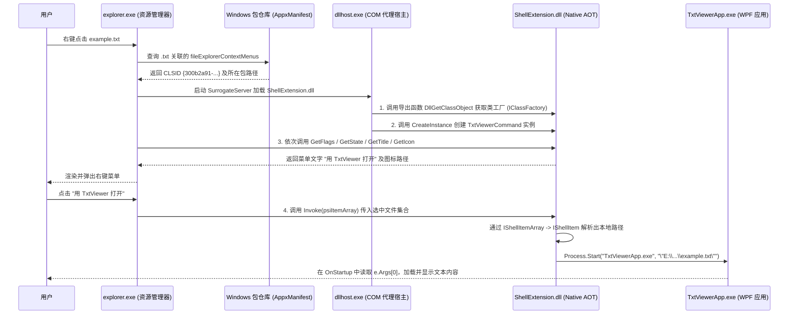

实现特定文件类型的右键菜单，在现代windows有好几种方式可以选择，不只是注册表，还有远古的com shell或者现在的IExplorerCommand。这取决于你的具体需求（如功能复杂度、Windows版本、部署方式等），有多种方案可供选择。

我们已知的最简单的办法，无需编写或者注册任何DLL，只需要在Windows的注册表里添加相应的键值，即可为特定文件类型或者所有文件添加右键菜单项。

在注册表的 `HKEY_CLASSES_ROOT` 下，为特定扩展名（如 `.txt`）或 ProgID（程序标识符）的 `shell` 子键下创建命令项。创建一个 `.reg` 文件并合并到注册表，或使用代码调用注册表 API 动态添加。但是缺点很明显，功能有限，只能执行静态命令，无法实现复杂动态菜单逻辑，因此我们这里主要想做的事COM Shell扩展的实现。

## COM shell

这个是传统win32的实现做法，原理是创建一个**进程内 COM 组件**（一个 DLL 文件），实现 `IShellExtInit` 和 `IContextMenu`（或其新版本）接口。

- **`IShellExtInit`**：用于初始化扩展，并接收用户选中的文件列表等信息。
- **`IContextMenu`**：核心接口，其 `QueryContextMenu` 方法负责动态添加菜单项，`InvokeCommand` 方法负责处理菜单点击事件。

可以实现完全动态的菜单、子菜单、图标、甚至根据文件状态动态启用/禁用菜单项。但是需要编写C++代码，注册COM组件，且糟糕的Shell扩展会导致资源管理器崩溃，很适合复杂交互、动态菜单逻辑或者集成第三方UI的场景。

## IExplorerCommand

这是现代方法的推荐，如果我们现在使用的是win11的平台，那么就很适合这个，这是微软推荐的新标准，用于扩展其现代化的右键菜单。工作原理是 实现`IExplorerCommand` 接口的**原生 COM DLL**，并通过**应用包清单**（MSIX）进行注册。

因此一个完整的菜单扩展由以下三个部分组成，原生COM DLL，用于实现IExplorerCommand接口，包含菜单逻辑；包清单：声明COM服务器和右键菜单扩展；应用标识：通过MSIX打包或者稀疏包为你的应用赋予身份，这是win11注册现代邮件菜单的必要条件。





### msix

MSIX的安装过程和Inno Setup在根本上的理念完全不同，Inno Setup是一个传统的安装程序制作工具，MSIX是一个由操作系统深度管理的应用部署和容器化格式。

MSIX里没有install和uninstall的概念，而是存在stage暂存和register注册的概念。

Stage：系统会解析MSIX包内的清单文件（`AppxManifest.xml`），然后创建一个安全的“包目录”（`pkgdir`），将应用的所有文件（负载）解压到这个目录中，并设置严格的访问控制列表（ACL）。这个目录对所有用户都是**只读**的，确保了文件的完整性。

Register：当某个用户第一次运行或“安装”这个应用时，系统会为该用户的配置文件“注册”这个已暂存的包。注册过程包括创建开始菜单项、关联文件类型、配置运行时数据等，使应用对该用户“可见”和“可用”。

一台机器上只需暂存一次应用文件，多个用户都可以注册使用，互不干扰。一个用户的注册或卸载操作，不会影响其他用户的可用应用列表


### 实践

我们可以从一个标准的.NET类库来开始，这是所有C# COM组件的起点，我们需要将其配置为 Native AOT 编译，来确保生成的DLL能被explorer.exe加载。

在 `.csproj` 文件中添加以下配置即可启用 Native AOT：

```xml
<PropertyGroup>
    <TargetFramework>net8.0</TargetFramework>
    <PublishAot>true</PublishAot>
    <NativeLib>Shared</NativeLib>
    <!-- 其他必要的配置，如 RuntimeIdentifier -->
</PropertyGroup>
```

可以参考以下**多项目解决方案**的结构：

```
MyShellExtension.sln
│
├── 📁 src/
│   ├── 📁 MyShellExtension.Core/          # 核心领域层
│   │   └── 📄 MyCommandService.cs
│   │
│   ├── 📁 MyShellExtension.ShellExtension/ # COM 互操作层
│   │   ├── 📄 IExplorerCommand.cs         # COM 接口定义
│   │   ├── 📄 MyExplorerCommand.cs        # COM 类实现
│   │   └── 📄 MyShellExtension.csproj     # Native AOT 配置
│   │
│   ├── 📁 MyShellExtension.Packaging/     # 打包与部署层
│   │   ├── 📄 AppxManifest.xml            # 稀疏包/MSIX 清单
│   │   └── 📄 build-and-register.ps1      # 注册脚本
│   │
│   └── 📁 MyShellExtension.App/           # 可选：主应用/宿主
│       └── 📄 MyShellExtension.exe
│
└── 📁 tests/
    └── 📁 MyShellExtension.Tests/
```

由于Windows Shell 扩展本质上是原生Win32 COM组件，因此系统加载DLL的时候会直接通过C ABI 查看导出函数 DllGetClassObject。使用 .NET 10 的 <PublishAot>true</PublishAot> + <NativeLib>Shared</NativeLib>，可以将 C#代码直接编译成纯原生机器码 DLL，无需在 explorer.exe / dllhost.exe 中初始化庞大的通用 CLR运行时，启动快且无运行时版本冲突。

Windows 11 的新版一级右键菜单强制要求扩展必须具有 MSIX 包身份也就是如下：


这里我们自己实现的TxtViewer就在一级菜单里，而不需要展开more options。win11的新版规定了这个必须要有msix包身份，但如果把整个应用打包进沙盒化的标准 MSIX，不仅调试麻烦，还会受到文件虚拟化限制，因此我们使用稀疏包，这是个特殊形式，.msix 包里只有一张 AppxManifest.xml 清单和图标，而真正的 ShellExtension.dll 和 TxtViewerApp.exe依然放在普通文件夹Publish\ 中通过-ExternalLocation 挂载。

>-ExternalLocation 和linux文件系统里的mount概念不同，这可以将一个msix包的身份标识，从默认的包安装目录，逻辑上指向并 并联到另一个外部位置的文件上。让传统的桌面程序无需改变分发方式，就能“挂靠”获得现代 Windows 应用的能力。

IExplorerCommand.cs 根据上面的文件目录来收，它的作用是COM接口定义，这里包含了IID信息，这个guid是可以通过命令生成的：IID: a08ce4d0-fa25-44ab-b57c-c7b1c323e0b9。

右键菜单的核心接口包含了：
1. 获取标题
2. 获取图标
3. 获取启用/隐藏状态
4. 点击执行
等8个严格顺序排列的虚函数。

```cs
[GeneratedComInterface]
[Guid("a08ce4d0-fa25-44ab-b57c-c7b1c323e0b9")]
public partial interface IExplorerCommand
{
    [PreserveSig]
    int GetTitle(IntPtr psiItemArray, out IntPtr ppszName);

    [PreserveSig]
    int GetIcon(IntPtr psiItemArray, out IntPtr ppszIcon);

    [PreserveSig]
    int GetToolTip(IntPtr psiItemArray, out IntPtr ppszInfotip);

    [PreserveSig]
    int GetCanonicalName(out Guid pguidCommandName);

    [PreserveSig]
    int GetState(IntPtr psiItemArray, [MarshalAs(UnmanagedType.Bool)] bool fOkToBeSlow, out uint pCmdState);

    [PreserveSig]
    int Invoke(IntPtr psiItemArray, IntPtr pbc);

    [PreserveSig]
    int GetFlags(out uint pFlags);

    [PreserveSig]
    int EnumSubCommands(out IntPtr ppEnum);
}
```

PreserveSig 是.NET中用于控制COM互操作时方法签名转换行为的一个特性，让 .NET 运行时“自动翻译”COM 方法返回的 `HRESULT` 错误码，还是保留原生签名，让开发者自己处理。你加了这个，运行时就不会做转换了，托管方法的签名 参数和返回值就和COM方法的签名保持完全一致了，方法的返回值会直接是那个 `int` 类型的 `HRESULT`，即使 `HRESULT` 表示失败，也不会抛出 `COMException`。

和DLLImport有一些区别，如果你写过win32开发的话，会使用这个来平台调用user32.dll之类的动态链接库，`DllImport` 特性上的 `PreserveSig` **字段**，默认值是 **`true`**（即“保留原生签名”）。两者默认行为相反，需要注意区分。

我们要关注的就是上面说的那几个GetState、GetIcon、GetTitle、Invoke这几个方法。之后的几个用于增强体验或者实现更加复杂的菜单结构，不是必须实现的。无论实现哪几个方法，**`GetTitle`、`GetIcon`、`GetState` 以及菜单构建阶段的其他方法，都运行在文件资源管理器的UI线程上**。

这意味着，这些方法**必须立即返回**，绝不能在其中执行任何耗时的操作，比如网络请求、读取大文件或复杂的磁盘I/O。否则，会直接导致用户右键点击时，整个文件资源管理器界面卡死。耗时的业务逻辑必须放到 `Invoke` 方法或异步任务中执行。

IShellItemArray 接口代表了用户在资源管理器中当前选中的所有文件和文件夹集合，我们在开发右键菜单的时候，它就是获取用户操作对象的核心入口：

```cs
/// <summary>
/// 表示 Shell 选中项集合的 COM 接口 (IShellItemArray)
/// </summary>
[GeneratedComInterface]
[Guid("b63ea76d-1f85-456f-a19c-48159efa858b")]
public partial interface IShellItemArray
{
    [PreserveSig]
    int BindToHandler(IntPtr pbc, in Guid bhid, in Guid riid, out IntPtr ppvOut);

    [PreserveSig]
    int GetPropertyStore(int flags, in Guid riid, out IntPtr ppv);

    [PreserveSig]
    int GetPropertyDescriptionList(IntPtr keyType, in Guid riid, out IntPtr ppv);

    [PreserveSig]
    int GetAttributes(int attribFlags, uint sfgaoMask, out uint psfgaoAttribs);

    [PreserveSig]
    int GetCount(out uint pdwNumItems);

    [PreserveSig]
    int GetItemAt(uint dwIndex, out IntPtr ppsi);

    [PreserveSig]
    int EnumItems(out IntPtr ppenumShellItems);
}
```

**核心方法**有`GetCount(out uint pdwNumItems)` ：获取用户当前选中的文件/文件夹数量； `GetItemAt(uint dwIndex, out IntPtr ppsi)`：根据索引，获取集合中某一个具体的文件/文件夹，比如你获取到的ppsi是一个IShellItem接口的指针，你需要把它转换为IShellItem才能继续操作，比如调用`GetDisplayName` 获取真实的物理路径； `GetAttributes(int attribFlags, uint sfgaoMask, out uint psfgaoAttribs)` 的作用是获取选中项的属性，用于判断选中的东西是什么，你可以通过传入 `SFGAO_FOLDER` 掩码来检查用户选中的是不是文件夹，或者通过 `SFGAO_FILESYSTEM` 检查它是不是真实的磁盘文件（而不是虚拟对象）。这对于决定是否显示或启用你的菜单项至关重要。

然后就是刚才讲到的IShellItem接口，表示选中项文件的接口：

```cs
/// <summary>
/// 表示单个 Shell 项（文件或文件夹）的 COM 接口 (IShellItem)
/// </summary>
[GeneratedComInterface]
[Guid("43826d1e-e718-42ee-bc55-a1e261c37bfe")]
public partial interface IShellItem
{
    [PreserveSig]
    int BindToHandler(IntPtr pbc, in Guid bhid, in Guid riid, out IntPtr ppv);

    [PreserveSig]
    int GetParent(out IntPtr ppsi);

    [PreserveSig]
    int GetDisplayName(uint sigdnName, out IntPtr ppszName);

    [PreserveSig]
    int GetAttributes(uint sfgaoMask, out uint psfgaoAttribs);

    [PreserveSig]
    int Compare(IntPtr psi, uint hint, out int piOrder);
}
```

我们在这里要关注的比较少，最常用的是 `GetDisplayName`方法，这在我们右键菜单开发里的使用频率极高，作用是获取该Shell项的各种形式的名称或者路径。关键在于它的第一个参数 `sigdnName`（SIGDN 枚举），它决定了你拿到的是什么格式的字符串。对于 C# 开发者，最常用的是以下两个：

- **`SIGDN_FILESYSPATH` (0x80058000)**：获取**真实的物理文件系统路径**（如 `C:\Users\20742\Desktop\test.txt`）。如果你需要对文件进行传统的 IO 操作（如读取、压缩、上传），必须用它。
- **`SIGDN_NORMALDISPLAY` (0x00000000)**：获取**在资源管理器中显示的名字**（如 `test.txt` 或 `此电脑`）。如果用户选中的是虚拟对象（如网盘、控制面板项），这个方法依然能返回友好的名字。

`GetDisplayName` 返回的 `ppszName` 是一个非托管内存指针（`PWSTR`）。**你必须手动释放它**，否则会内存泄漏。C# 里的标准做法是：

```cs
// 假设你拿到了 IShellItem 对象 shellItem
shellItem.GetDisplayName(0x80058000, out IntPtr ppszName); // 0x80058000 = SIGDN_FILESYSPATH
if (ppszName != IntPtr.Zero)
{
    string filePath = Marshal.PtrToStringUni(ppszName); // 转换
    Marshal.FreeCoTaskMem(ppszName); // 必须释放！
}

// 这里不能用using，因为using要求被管理对象要实现IDisposable接口，但是IntPtr是一个值类型结构体，string是不可变引用类型，都不实现，此外，`Marshal.PtrToStringUni` 只是把非托管内存里的数据复制成托管的字符串，它并不拥有或接管那块非托管内存的所有权。
```

 `GetAttributes` 和`IShellItemArray` 里的同名方法类似，它用于判断这个具体对象是什么类型的。在 `Invoke` 中，你遍历了一堆文件，想知道其中哪些是文件夹。你可以传入 `SFGAO_FOLDER` 掩码来判断。`GetParent`很少用。如果你拿到了 `C:\test\a.txt` 的路径，直接用 C# 的 `Path.GetDirectoryName(path)` 就能拿到父目录，不需要再绕到底层去调这个 COM 接口。

IClassFactory用于连接c#代码和windows资源管理器。因为com中，资源管理器不会new我们的类，它会根据注册表里的CLSID找到我们的DLL后要求我们的DLL提供工厂，这个工厂就是IClassFactory。


```cs
/// <summary>
/// 标准 COM 类工厂接口 (IClassFactory)
/// </summary>
[GeneratedComInterface]
[Guid("00000001-0000-0000-C000-000000000046")]
public partial interface IClassFactory
{
    [PreserveSig]
    int CreateInstance(IntPtr pUnkOuter, in Guid riid, out IntPtr ppvObject);

    [PreserveSig]
    int LockServer([MarshalAs(UnmanagedType.Bool)] bool fLock);
}
```

CreateInstance用于生成**写的 `IExplorerCommand` 实例**的方法。当你在右键菜单触发时，资源管理器会调用这个方法。pUnkOuter是用于COM聚合，如果是用于右键菜单，资源管理器通常会传 `IntPtr.Zero`（即 `null`），表示不需要聚合。如果你不支持聚合，直接检查它是否为 `Zero`，若不是则返回 `CLASS_E_NOAGGREGATION`。riid是一个Guid类型，对于右键菜单，它会传入 `IExplorerCommand` 的 GUID。你需要检查这个 `riid`，确保它要的是你支持的接口。ppvObject为输出参数，如果确认riid无误，你需要在这里**创建你写的那个类（实现了 `IExplorerCommand` 的类）的实例**，并将它的指针赋值给 `ppvObject`。

比如下面：

```cs
public int CreateInstance(IntPtr pUnkOuter, in Guid riid, out IntPtr ppvObject)
{
    ppvObject = IntPtr.Zero;

    // 1. 拒绝聚合（通常右键菜单不需要）
    if (pUnkOuter != IntPtr.Zero)
        return unchecked((int)0x80040110); // CLASS_E_NOAGGREGATION

    // 2. 检查它要的是不是 IExplorerCommand 接口
    if (riid == typeof(IExplorerCommand).GUID)
    {
        // 3. 实例化你写的命令类
        var command = new MyExplorerCommand(); 
        
        // 4. 将 C# 对象转换为 COM 指针返回（使用 .NET 8 源生成器的 API）
        ppvObject = ComInterfaceMarshaller<IExplorerCommand>.ConvertToUnmanaged(command);
        return 0; // S_OK
    }

    return unchecked((int)0x80004002); // E_NOINTERFACE
}
```

LockServer用来控制**DLL 何时可以从内存中卸载**的，fLock = true可以增加一个锁计数器，如果有外部程序在使用我们的DLL，或者准备创建大量对象，就不要把DLL移除内存。你设置为false就是减少计数器，表示外部程序用完了。只有当这个计数器归零，**并且**你所有创建的对象（`MyExplorerCommand`）都被释放（引用计数为 0）时，你的 DLL 才能安全卸载。

```cs
private static int _lockCount = 0;

public int LockServer([MarshalAs(UnmanagedType.Bool)] bool fLock)
{
    if (fLock)
        Interlocked.Increment(ref _lockCount);
    else
        Interlocked.Decrement(ref _lockCount);

    // 如果 _lockCount 变为 0，并且没有活动对象，可以在这里触发清理逻辑
    return 0; // S_OK
}
```

这样就是所有接口的定义了，接下来我们开始来实现他们，我们的目标只是对txt文件进行右键菜单的扩展，因此实现起来还是比较简单。

ComServer.cs是COM DLL的导出入口和类工厂实现，这是 Windows 系统加载 ShellExtension.dll 时的入口。


```cs
/// <summary>
/// 用于实例化 TxtViewerCommand 的 COM 类工厂
/// </summary>
[GeneratedComClass]
public partial class TxtViewerClassFactory : IClassFactory
{
    private const int S_OK = 0;
    private const int CLASS_E_NOAGGREGATION = unchecked((int)0x80040110);

    public int CreateInstance(IntPtr pUnkOuter, in Guid riid, out IntPtr ppvObject)
    {
        ppvObject = IntPtr.Zero;

        if (pUnkOuter != IntPtr.Zero)
        {
            return CLASS_E_NOAGGREGATION; // 我们的组件不需要聚合
        }

        var command = new TxtViewerCommand();
        IntPtr unk = ComServer.ComWrappersInstance.GetOrCreateComInterfaceForObject(command, CreateComInterfaceFlags.None);
        try
        {
            return Marshal.QueryInterface(unk, in riid, out ppvObject);
        }
        finally
        {
            Marshal.Release(unk);
        }
    }

    public int LockServer(bool fLock)
    {
        return S_OK;
    }
}
```

由于资源管理器传给`CreateInstance` 的 `riid` 是动态的。它可能要求 `IExplorerCommand`，也可能要求 `IUnknown`。所以这里需要使用查询语句：

```cs
Marshal.QueryInterface(unk, in riid, out ppvObject);
```

`QueryInterface` 会自动帮你在 `unk` 指针指向的 COM 对象中查找对应的接口。如果支持，返回 `S_OK`；不支持，返回 `E_NOINTERFACE`。

>unk是一个指向`IUnknown` COM 接口的非托管指针，是c#对象的COM包装器，在c#的内存里创建一个纯托管c#对象，资源管理器看不到。`GetOrCreateComInterfaceForObject` 的作用，就是在非托管内存堆上，为你的 C# 对象生成一个COM 可调用包装。它指向一块包含vtable的内存，通过它，资源管理器可以调用标准com方法。

这里注意内存管理，一定要记得释放。

```cs
try
{
    return Marshal.QueryInterface(unk, in riid, out ppvObject);
}
finally
{
    Marshal.Release(unk);
}
```

然后就是COM DLL导出的入口了：

```cs
/// <summary>
/// Native AOT 导出的标准 COM DLL 入口函数
/// </summary>
public static unsafe class ComServer
{
    private const int S_FALSE = 1;
    private const int E_INVALIDARG = unchecked((int)0x80070057);
    private const int CLASS_E_CLASSNOTAVAILABLE = unchecked((int)0x80040111);

    internal static readonly StrategyBasedComWrappers ComWrappersInstance = new();

    [UnmanagedCallersOnly(EntryPoint = "DllGetClassObject")]
    public static int DllGetClassObject(Guid* rclsid, Guid* riid, IntPtr* ppv)
    {
        if (rclsid == null || riid == null || ppv == null)
        {
            return E_INVALIDARG;
        }

        *ppv = IntPtr.Zero;

        if (*rclsid != TxtViewerCommand.Clsid)
        {
            return CLASS_E_CLASSNOTAVAILABLE;
        }

        var factory = new TxtViewerClassFactory();
        IntPtr unk = ComWrappersInstance.GetOrCreateComInterfaceForObject(factory, CreateComInterfaceFlags.None);
        try
        {
            return Marshal.QueryInterface(unk, in *riid, out *ppv);
        }
        finally
        {
            Marshal.Release(unk);
        }
    }

    [UnmanagedCallersOnly(EntryPoint = "DllCanUnloadNow")]
    public static int DllCanUnloadNow()
    {
        return S_FALSE;
    }
}
```

这个代码一般是可以复制作为模板使用的，比较固定，在 Windows 的 COM 规范中，`DllGetClassObject`、`DllCanUnloadNow` 这些导出函数的签名、参数类型和内存管理逻辑，是被**操作系统写死**的。需要改的只有CLSID和具体类名的替换。

但是这里缺少 `DllRegisterServer` 和 `DllUnregisterServer`，标准的 COM DLL 通常会导出这两个函数，用于执行 `regsvr32 your.dll` 时自动向注册表写入右键菜单的配置（CLSID、文件类型关联等）。如果你完善了之后，可以作为inno setup的安装流程的一部分来自动注册右键菜单。Inno Setup 内置了 `RegisterServer` 和 `UnregisterServer` 函数，它们会自动调用系统的 `regsvr32.exe` 来加载你的 DLL，并执行其中的 `DllRegisterServer` 和 `DllUnregisterServer` 导出函数。

1. **在 Inno Setup 脚本中调用**：
    - 建议将 `RegisterServer` 函数放在 `[Code]` 段的 `CurStepChanged` 事件中，并选择 `ssPostInstall` 步骤，以确保在文件复制完成后再进行注册。
    - 卸载时，同样在 `CurStepChanged` 事件中，选择 `ssUninstall` 步骤，调用 `UnregisterServer`。

inno setup脚本里建议如下：
```ini
[Code]
procedure CurStepChanged(CurStep: TSetupStep);
begin
  if CurStep = ssPostInstall then
  begin
    // 安装时注册，True 表示64位DLL
    RegisterServer(False, True, ExpandConstant('{app}\YourDll.dll'), False);
  end
  else if CurStep = ssUninstall then
  begin
    // 卸载时注销
    UnregisterServer(False, True, ExpandConstant('{app}\YourDll.dll'), False);
  end;
end;
```

TxtViewerCommand.cs是具体的实现了，右键菜单的具体业务逻辑。这里就不展开来讲，我们接下来直接来看清单了。

我们来逐段拆解 AppxManifest.xml。

```xml
    <Package
        xmlns="http://schemas.microsoft.com/appx/manifest/foundation/windows10"
        xmlns:uap="http://schemas.microsoft.com/appx/manifest/uap/windows10"
        xmlns:uap10="http://schemas.microsoft.com/appx/manifest/uap/windows10/10"
        xmlns:rescap="http://schemas.microsoft.com/appx/manifest/foundation/windows10/restrictedcapabilities"
        xmlns:com="http://schemas.microsoft.com/appx/manifest/com/windows10"
        xmlns:desktop4="http://schemas.microsoft.com/appx/manifest/desktop/windows10/4"
        xmlns:desktop5="http://schemas.microsoft.com/appx/manifest/desktop/windows10/5"
        IgnorableNamespaces="uap uap10 rescap com desktop4 desktop5">
```

windwos的appx清单是按照windows10/11的版本演进分析在不同命名空间里的。uap10提供稀疏包所需的 AllowExternalContent、桌面进程运行行为 RuntimeBehavior="win32App"等属性。

rescap（受限能力）：允许传统 Win32 桌面程序突破 UWP 沙盒限制（如 runFullTrust）。
com：用于在包清单中注册进程内/进程外 COM 服务器（替代传统的 regsvr32 写注册表 HKCR\CLSID）。
desktop4 & desktop5：专门用于声明文件资源管理器右键菜单扩展（fileExplorerContextMenus）。

包的身份标识Identity：

```xml
   <Identity
        Name="YourCompany.TxtViewerShellExtension"
        Publisher="CN=YourPublisher"
        Version="1.0.0.0"
        ProcessorArchitecture="x64" />
```

这里有包名，前面所用证书。

包属性与稀疏包开关：

```xml
 <Properties>
        <DisplayName>Txt Viewer</DisplayName>
        <PublisherDisplayName>Your Company</PublisherDisplayName>
        <Logo>Assets\logo.png</Logo>
        <!-- 关键：允许外部内容，因为 DLL 和 EXE 位于稀疏包外部目录 -->
        <uap10:AllowExternalContent>true</uap10:AllowExternalContent>
</Properties>
```


系统依赖与权限声明：

```xml
<Dependencies>
	<TargetDeviceFamily Name="Windows.Desktop" MinVersion="10.0.19041.0" MaxVersionTested="10.0.22621.0" />
</Dependencies>

<Capabilities>
	<rescap:Capability Name="runFullTrust" />
	<rescap:Capability Name="unvirtualizedResources" />
</Capabilities>
```

 应用程序宿主节点：
 
```xml
    <Application
        Id="TxtViewerShellExtension"
        Executable="TxtViewerApp.exe"
        uap10:TrustLevel="mediumIL"
        uap10:RuntimeBehavior="win32App">
        <uap:VisualElements
            DisplayName="Txt Viewer"
            Description="Txt Viewer &amp; Shell Extension"
            BackgroundColor="transparent"
            Square150x150Logo="Assets\logo.png"
            Square44x44Logo="Assets\logo.png" />
```

所有的 `<Extensions>`（包括 COM 服务和右键菜单）都必须挂载在一个 `<Application>` 节点下。Executable="TxtViewerApp.exe"：指向外部目录 Publish\ 下的 WPF 主程序，uap10:TrustLevel="mediumIL" + uap10:RuntimeBehavior="win32App"：声明这是一个标准中等完整性级别的 Win32 桌面程序。<uap:VisualElements>：定义在系统开始菜单和已安装应用列表中显示的标题和图标（之前有 AppListEntry="none"时会在开始菜单中隐藏该应用，去掉后即可在开始菜单看到 Txt Viewer）。

核心扩展一：注册进程外 COM 服务器：

```xml
   <com:Extension Category="windows.comServer">
        <com:ComServer>
            <com:SurrogateServer DisplayName="TxtViewerCommand">
                <com:Class
                    Id="300b2a91-15c3-43c5-985f-c792baaa9009"
                    Path="ShellExtension.dll"
                    ThreadingModel="Both" />
            </com:SurrogateServer>
        </com:ComServer>
    </com:Extension>
```
这一段替代了传统的 regsvr32 注册表写入，将信息注册到系统的 PackagedCom 数据库中。com:SurrogateServer是代理进程服务器，让windows不要把 ShellExtension.dll 直接塞进 explorer.exe 进程内部，而是启动一个独立的系统代理进程 dllhost.exe 来加载 ShellExtension.dll，这样就算扩展有bug，也不会把资源管理器弄崩溃。

ThreadingModel="Both"：声明该 COM 类同时支持单线程单元（STA）和多线程单元（MTA），与 .NET Native AOT 的 StrategyBasedComWrappers完全匹配。

核心扩展二：绑定文件右键菜单：

```xml
    <desktop4:Extension Category="windows.fileExplorerContextMenus">
        <desktop4:FileExplorerContextMenus>
            <desktop5:ItemType Type=".txt">
                <desktop5:Verb
                    Id="TxtViewerOpen"
                    Clsid="300b2a91-15c3-43c5-985f-c792baaa9009" />
            </desktop5:ItemType>
        </desktop4:FileExplorerContextMenus>
    </desktop4:Extension>
```

 这一段负责把上面的 COM 类挂载到具体的文件类型上。desktop5:ItemType Type=".txt"指定了触发右键菜单的目标类型，写 .txt：仅对 .txt 后缀文件显示；写 `*`：对所有文件显示（如压缩软件 Bandizip、VS Code）；写 Directory：对文件夹显示；写 Directory\Background：在文件夹空白处右键时显示。

如果不用 AppxManifest.xml，只用 Inno Setup + 注册表 / DllRegisterServer 会怎样？在 Windows 10 或 Win11 的“显示更多选项（经典菜单）”中的时候，清单文件就完全不需要了，一级菜单则不会显示。

传统方式的无清单文件模式下，，特定文件类型在哪定义。如果只走传统 COM 注册，不需要 AppxManifest.xml。特定文件类型是在 Inno Setup 脚本（.iss）的 `[Registry]` 段，或者写在 DllRegisterServer 函数内部。只需在 Inno Setup 的 .iss 脚本中写两部分注册表即可：

```iss
[Registry]
; 1. 注册 COM 组件的 CLSID 与 DLL 路径（替代 DllRegisterServer）
Root: HKCU; Subkey: "Software\Classes\CLSID\{{300b2a91-15c3-43c5-985f-c792baaa9009}"; ValueType: string;
ValueName: ""; ValueData: "TxtViewerCommand"; Flags: uninsdeletekey
Root: HKCU; Subkey: "Software\Classes\CLSID\{{300b2a91-15c3-43c5-985f-c792baaa9009}\InprocServer32";
ValueType: string; ValueName: ""; ValueData: "{app}\ShellExtension.dll"; Flags: uninsdeletekey
Root: HKCU; Subkey: "Software\Classes\CLSID\{{300b2a91-15c3-43c5-985f-c792baaa9009}\InprocServer32";
ValueType: string; ValueName: "ThreadingModel"; ValueData: "Both"; Flags: uninsdeletekey

; 2. 定义对哪些特定类型文件生效（将 CLSID 挂载到 ExplorerCommandHandler）
;    - 针对 .txt 文件：写到 SystemFileAssociations\.txt\shell\<自定义名称>
;    - 针对所有文件：写到 *\shell\<自定义名称>
;    - 针对文件夹：写到 Directory\shell\<自定义名称>
Root: HKCU; Subkey: "Software\Classes\SystemFileAssociations\.txt\shell\TxtViewerOpen"; ValueType: string;
ValueName: "ExplorerCommandHandler"; ValueData: "{{300b2a91-15c3-43c5-985f-c792baaa9009}"; Flags:
uninsdeletekey
```

>注：在 Inno Setup 脚本中，左花括号 { 需要写成双花括号 {{ 进行转义。如果你选择在 C# 的 DllRegisterServer 中用Registry.CurrentUser.CreateSubKey(...) 写上面这两处注册表，那么在 Inno Setup 的 `[Files]` 段只需给 DLL 加上Flags: regserver 即可。

## COM组件

我们简单了解一下COM组件，因为windows的资源管理器完全就是一个基于COM构建的庞然大物。COM是语言无关的，只要按照COM标准导出函数，windows的Explorer就可以调用你，这意味着我们不需要拿到Explorer的源代码，就可以实现插件，我们使用的桌面、任务栏等其他组件底层完全都是COM，Windows中大量的核心API都是以COM接口形式存在和暴露。

基于COM，我们可以实现Office自动化，常用的 `Microsoft.Office.Interop` 底层就是 COM。还有我们这里说的Shell扩展；硬件与驱动交互，很多底层设备通信，WMI查询都需要通过COM接口完成。WINRT的ABI也是基于COM的现代化改造。

具体的介绍可以看微软文档：

组件对象模型门户：[https://learn.microsoft.com/zh-cn/windows/win32/com/component-object-model--com--portal](https://learn.microsoft.com/zh-cn/windows/win32/com/component-object-model--com--portal)

COM技术概述：[https://learn.microsoft.com/zh-cn/windows/win32/com/com-technical-overview](https://learn.microsoft.com/zh-cn/windows/win32/com/com-technical-overview)

